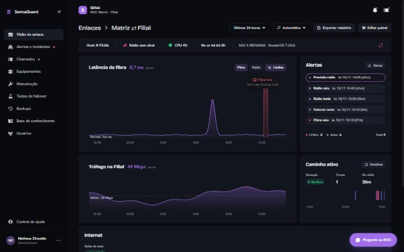
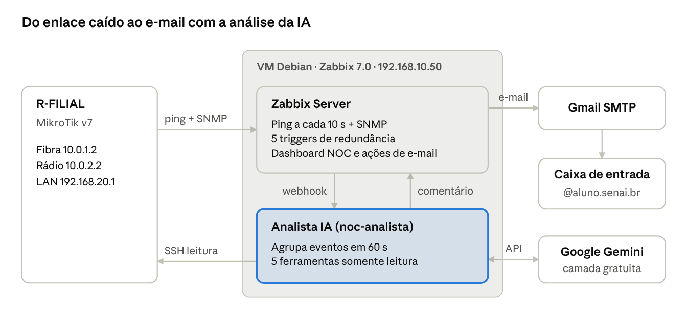
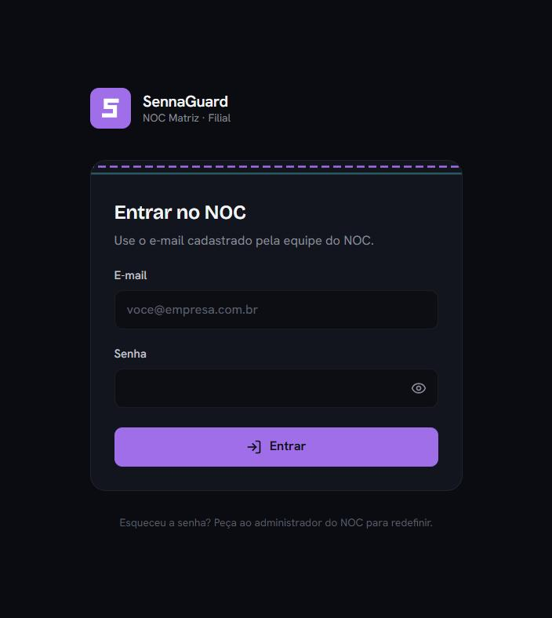

# NOC SENAI — Monitoramento de Redundância de Enlace

Centro de Operações de Rede (NOC) que monitora a redundância **Fibra/Rádio** entre duas unidades, detecta o *failover* em segundos e investiga cada incidente com um analista assistido por IA. Projeto de TCC (SENAI, 2026) construído sobre a mesma stack de um ambiente de produção: Zabbix 7.0, Grafana, um painel web próprio (SennaGuard) e roteadores MikroTik em bancada real.

## Visão geral

A Matriz e a Filial se interligam por dois caminhos sob OSPF: a **fibra** (custo 10) transporta o tráfego e o **rádio** (custo 100) assume quando a fibra degrada ou cai. O NOC instrumenta esse enlace de ponta a ponta — da coleta SNMP e dos testes de alcance até o alerta por e-mail — e mede, a cada queda, o tempo exato que a rede leva para convergir no caminho de backup.

Três pilares sustentam a operação:

- **Observabilidade.** Zabbix 7.0 coleta SNMP e testa cada enlace por *ping*; uma sonda dedicada de 1 s detecta queda em ~2 s. Dashboards no Zabbix e no Grafana (modo TV) expõem o estado em tempo real.
- **Resposta assistida por IA.** Ao abrir um incidente, um analista baseado em LLM investiga Zabbix e MikroTik por ferramentas somente leitura e entrega linha do tempo, causa provável, impacto e ações recomendadas.
- **Operação.** O painel SennaGuard concentra alertas, chamados com SLA, manutenções, backups de configuração e testes de *failover*, com acesso segregado por perfil.

## Arquitetura

O servidor é uma VM Debian 12 sobre VMware ESXi, posicionada na LAN da Matriz. O Zabbix detecta a queda e dispara o alerta; em paralelo, aciona o analista de IA, que investiga e devolve o laudo ao evento — que vira o segundo e-mail. Nenhum script carrega endereços fixos: topologia e credenciais ficam em `/etc/noc/noc.conf` e em arquivos `chmod 600`, fora do repositório.

O repositório separa as **duas frentes** do projeto — a infraestrutura de rede (NOC) e a plataforma web (SennaGuard) — em uma estrutura enxuta:

| Pasta | Responsabilidade |
| --- | --- |
| [`noc/`](noc) | Orquestração do Zabbix via API, serviço do Analista IA, dashboards e chamados (Python) |
| [`sennaguard/`](sennaguard) | Painel web do NOC — API FastAPI + interface React/TypeScript |
| [`routeros/`](routeros) | Configuração dos MikroTik e switches (OSPF, netwatch, firewall, redundância WAN) |
| [`infra/`](infra) | Infraestrutura de apoio: bancada, provisionamento do Grafana, segurança do servidor e unidades de sistema |
| [`instalacao/`](instalacao) | Instaladores e guias de implantação em servidor novo |
| [`docs/`](docs/DOCUMENTACAO.md) | Documentação técnica de referência e a apresentação do projeto |
| [`arquivo/`](arquivo) | Material legado mantido como referência histórica |

A **documentação técnica completa**, dividida em *Parte 1 — Infraestrutura de Rede (NOC)* e *Parte 2 — Plataforma SennaGuard*, está em [`docs/DOCUMENTACAO.md`](docs/DOCUMENTACAO.md). A apresentação final (`.pptx`/`.pdf`) está em [`docs/apresentacao/`](docs/apresentacao).

## Capacidades

**Monitoramento e detecção**
- SNMP do R-FILIAL e das antenas; *ping* de cada enlace a cada 5 s e alcance da LAN remota a cada 1 s.
- Loopback `/32` por roteador como *router-id* OSPF e alvo de monitoramento, alcançável pela fibra ou pelo rádio.
- Nove *triggers* que distinguem fibra caída com rádio assumindo, rádio caído, Filial isolada, *failover* lento e fibra instável — e antecipam a queda quando o rádio começa a degradar.
- Cronometragem do *failover* em segundos a cada evento.

**Resposta a incidentes**
- Analista de IA (Google Gemini) com seis ferramentas somente leitura sobre Zabbix e MikroTik.
- Chamados automáticos (`NOC-xxx`) para quedas acima de 1 h, com e-mail formal ao cliente.
- Registro de chamados em livro encadeado por **SHA-256**, com verificação de integridade.

**Operação (SennaGuard)**
- Acesso por perfil (Administrador, Analista, Operador, Cliente), validado no servidor.
- Backups diários de configuração dos roteadores, com *diff* entre versões e explicação por IA.
- Teste de *failover* sob aprovação, manutenções programadas, base de conhecimento, notificações por Telegram, relatórios de SLA em PDF e modo TV.

## Stack

| Camada | Tecnologia |
| --- | --- |
| Monitoramento | Zabbix 7.0 LTS, SNMP, Grafana |
| Servidor | Debian 12 em VMware ESXi, Apache + HTTPS com CA própria |
| Backend | Python, FastAPI, SQLite |
| Frontend | React 19, TypeScript, Tailwind CSS, Vite |
| IA | Google Gemini (ferramentas somente leitura) |
| Rede | MikroTik hEX S (RouterOS 7), Ubiquiti PowerBeam M5, OSPF |

## Interface

O SennaGuard entrega o estado do NOC com login por perfil, tempo real via SSE e temas claro/escuro.

## Resultados em bancada real

Validado com dois MikroTik hEX S (RouterOS 7.24.5) e duas antenas Ubiquiti PowerBeam M5:

| Métrica | Resultado |
| --- | --- |
| Latência da fibra (sfp1) | ~0,6 ms, OSPF estável |
| Enlace de rádio (ether1) | sinal de −53/−52 dBm, 0% de perda, 6,4 ms |
| Convergência no *failover* | **3,9 s** da queda da fibra até o rádio assumir |
| Retorno à fibra | sem perda |

## Implantação

Instalação completa em um Debian 12 limpo a partir de um único instalador, documentada em [`instalacao/`](instalacao). O NOC (Zabbix, banco, Apache com HTTPS, Grafana, Analista IA, e-mail, backup) sobe com um comando; o painel sobe com outro. Endereços e segredos são parametrizados, nunca versionados.

## Roadmap

- **Alta disponibilidade** do próprio NOC: réplica da VM e backup puxado para fora do servidor, mitigando o ponto único de falha.
- **SNMPv3** com autenticação e privacidade, substituindo a comunidade v2c.
- **Segmentação** do plano de gerência em VLAN dedicada.
- **Auto-monitoramento do servidor** e endurecimento contra DoS na camada web.

## Segurança

Nenhuma senha, token ou chave está versionada. Credenciais residem em arquivos `chmod 600` no servidor; nos scripts RouterOS as senhas aparecem como marcadores a preencher na aplicação. O acesso ao painel usa HTTPS com CA própria, sessões `HttpOnly`/`SameSite`, bloqueio por tentativas e autorização por perfil no servidor.

## Licença

Distribuído sob a licença [MIT](LICENSE).
