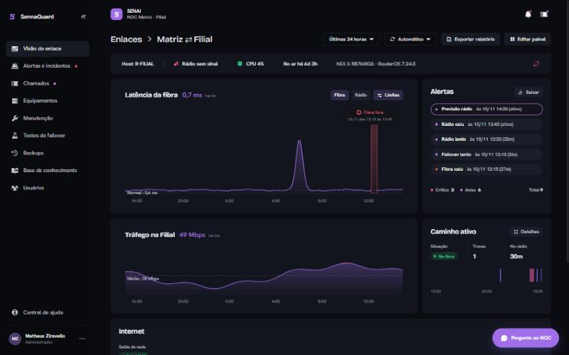
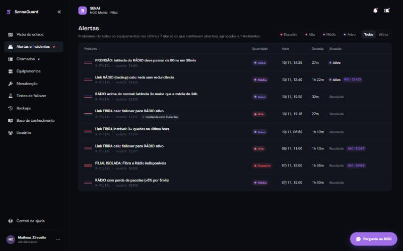
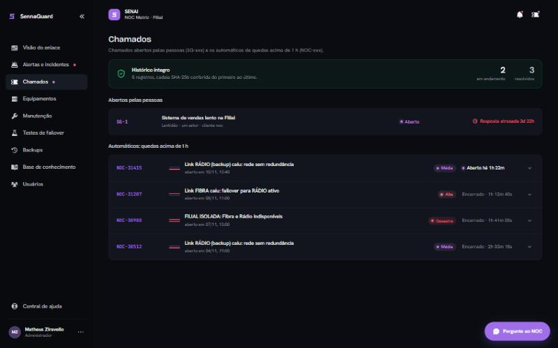
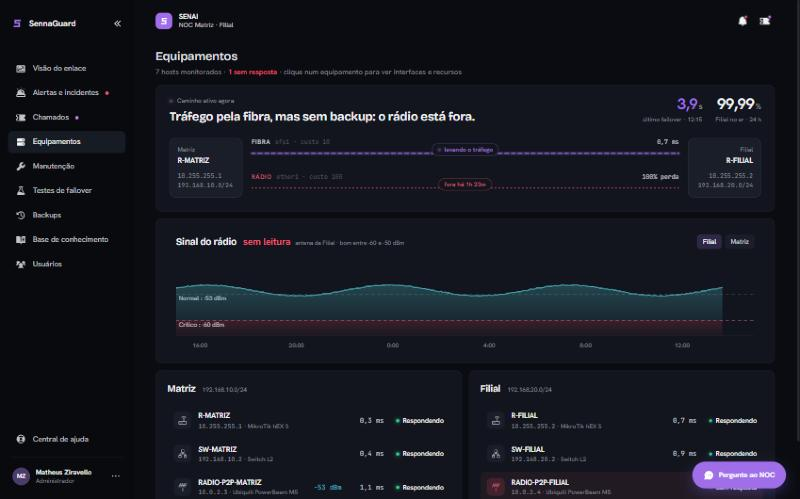
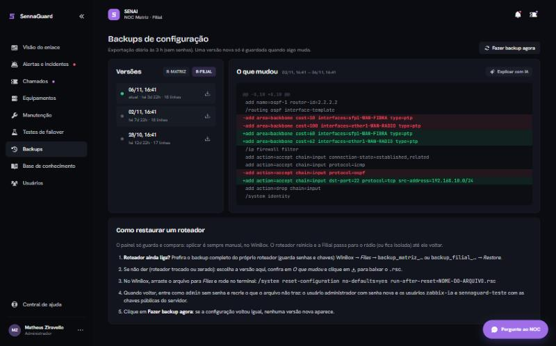
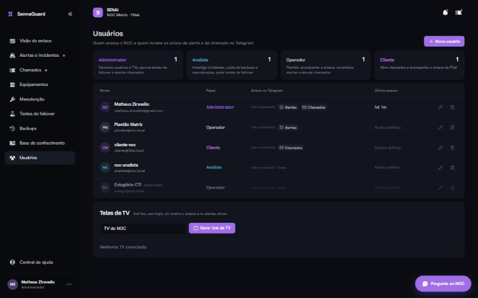

# Documentação Técnica — NOC SENAI + SennaGuard

**Trabalho de Conclusão de Curso · 2026 · Matheus Ziravello**

Projeto de infraestrutura de rede redundante entre Matriz e Filial e plataforma de monitoramento, gestão de incidentes e auditoria. O documento está dividido em duas frentes complementares de um mesmo projeto:

- **Parte 1 — Infraestrutura de Rede (NOC):** a camada física e lógica — roteadores, enlaces de fibra e rádio, redundância de acesso à internet, servidor de monitoramento e a pilha de software que leva o evento de rede até o alerta analisado.
- **Parte 2 — Plataforma SennaGuard:** a aplicação web que apresenta o estado do enlace em tempo real, controla o acesso por perfil e registra alertas e chamados de forma auditável.

A infraestrutura garante a continuidade da comunicação; a plataforma comprova e registra o seu funcionamento.

> A apresentação final, com todos os diagramas e capturas de tela, está em [`docs/apresentacao/`](apresentacao/) (arquivos `.pptx` e `.pdf`). O repositório é **privado** e nenhuma credencial é versionada.

---

## Sumário

**Parte 1 — Infraestrutura de Rede (NOC)**
1. Visão geral e topologia lógica
2. Roteador da Matriz (R-MATRIZ)
3. Roteador da Filial (R-FILIAL)
4. Redundância de enlace — fibra e rádio (OSPF)
5. Redundância de acesso à internet (VIVO/TIN)
6. Plano de endereçamento IP
7. Servidor de monitoramento
8. Pilha de software
9. Monitoramento no Zabbix
10. Painéis — Zabbix, Grafana e mapa
11. Notificações
12. Analista de incidentes com IA
13. Segurança e resiliência do servidor
14. Operação e diagnóstico

**Parte 2 — Plataforma SennaGuard**
15. Arquitetura
16. Painel do enlace em tempo real
17. Controle de acesso por perfil
18. Alertas com análise por IA
19. Chamados com histórico auditável
20. Equipamentos e topologia ao vivo
21. Manutenção, testes de failover e backups
22. Conhecimento, usuários e assistente
23. Segurança da aplicação

**Anexos**
- A. Instalação
- B. Referência de acesso
- C. Evolução e roadmap
- D. Fundamentação técnica
- E. Estrutura do repositório

---

# PARTE 1 — INFRAESTRUTURA DE REDE (NOC)

## 1. Visão geral e topologia lógica

A Matriz e a Filial são interligadas por **dois enlaces independentes** sob roteamento dinâmico OSPF. A Matriz concentra o acesso à internet e o servidor de monitoramento; a Filial não possui saída direta para a internet e encaminha todo o tráfego à Matriz por qualquer um dos enlaces.

| Enlace | Meio | Interface | Rede | Custo OSPF | Papel |
| --- | --- | --- | --- | --- | --- |
| Principal | Fibra óptica | `sfp1` ↔ `sfp1` | 10.0.1.0/30 | 10 | Carrega o tráfego |
| Contingência | Rádio P2P | `ether1` | 10.0.2.0/29 | 100 | Assume na falha da fibra |

O tráfego segue sempre pelo enlace de menor custo (fibra). Em caso de falha, o rádio assume automaticamente, sem intervenção. Cada roteador possui uma **loopback /32** (R-MATRIZ `10.255.255.1`, R-FILIAL `10.255.255.2`), anunciada no OSPF e usada como *router-id* e como endereço de monitoramento — alcançável pela fibra **ou** pelo rádio.


A plataforma foi validada em bancada real (dois MikroTik hEX S e duas antenas Ubiquiti PowerBeam M5) e opera em servidor dedicado, reinstalável de ponta a ponta a partir do repositório.

## 2. Roteador da Matriz (R-MATRIZ)

O acesso à internet é concentrado em um único equipamento; o servidor de rack utiliza portas dedicadas. MikroTik RouterOS v7, MTU de 2000 bytes em todas as interfaces, loopback `10.255.255.1/32` como *router-id* do OSPF.

| Porta | Nome | Função | Conexão |
| --- | --- | --- | --- |
| `ether1` | ether1-WAN-RADIO | Rádio (contingência) · 10.0.2.1/29 | Fonte PoE da antena RADIO-P2P-MATRIZ |
| `ether2` | ether2-INTERNET | Internet da escola (DHCP) · link VIVO | Ponto de rede da escola |
| `ether3` | ether3-LAN | Rede local | SW-MATRIZ: notebook e iDRAC do servidor |
| `ether4` | ether4-TIN | Internet de contingência (DHCP) · link TIN | Segundo ponto de rede da escola |
| `ether5` | ether5-LAN | Rede local | Dell PowerEdge T440: ESXi (192.168.10.40) e VMs |
| `sfp1` | sfp1-WAN-FIBRA | Fibra (principal) · 10.0.1.1/30 | Módulo SFP até a `sfp1` do R-FILIAL |

Script de referência: [`routeros/r-matriz.rsc`](../routeros/r-matriz.rsc). A configuração real exportada do equipamento em operação está em [`routeros/estado-atual/R-MATRIZ.rsc`](../routeros/estado-atual/R-MATRIZ.rsc).

## 3. Roteador da Filial (R-FILIAL)

A Filial administra apenas o próprio roteador, sem acesso à Matriz ou às antenas. Loopback `10.255.255.2/32` como *router-id* e host monitorado pelo Zabbix.

| Porta | Nome | Função | Conexão |
| --- | --- | --- | --- |
| `ether1` | ether1-WAN-RADIO | Rádio (contingência) · 10.0.2.2/29 | Fonte PoE da antena RADIO-P2P-FILIAL |
| `ether2` | ether2-reserva | Reserva (sem uso · alerta desativado) | — |
| `ether3`–`ether5` | ether3/4/5-LAN | Rede local (bridge) | PC da Filial (DHCP) e portas disponíveis |
| `sfp1` | sfp1-WAN-FIBRA | Fibra (principal) · 10.0.1.2/30 | Módulo SFP até a `sfp1` do R-MATRIZ |

Scripts de referência: [`routeros/r-filial.rsc`](../routeros/r-filial.rsc) e o bloco de integração com o NOC [`routeros/routeros-r-filial-noc.rsc`](../routeros/routeros-r-filial-noc.rsc). Configuração real em [`routeros/estado-atual/R-FILIAL.rsc`](../routeros/estado-atual/R-FILIAL.rsc). O modelo para novas unidades é [`routeros/template-nova-filial.rsc`](../routeros/template-nova-filial.rsc).

## 4. Redundância de enlace — fibra e rádio (OSPF)

O OSPF troca de caminho sozinho quando a fibra **cai**. Para também trocar quando ela **degrada** (lenta ou com perda, sem derrubar o link), cada roteador roda um *netwatch* de qualidade (RouterOS 7.4+):

1. A cada 10 s, 20 *pings* para a outra ponta da fibra.
2. Média acima de 30 ms **ou** perda acima de 10%: o custo OSPF da fibra sobe de 10 para 200 (acima dos 100 do rádio) e o tráfego migra para o rádio com a fibra ainda ativa.
3. Quando a fibra volta a ficar boa, o custo retorna a 10.

Os temporizadores do OSPF foram reduzidos para `hello 1 s` / `dead 4 s`: uma fibra que para de passar tráfego sem derrubar o link (conversor travado, SFP defeituoso) é detectada em ~4 s, não em 40 s. Os dois roteadores devem receber o ajuste em sequência imediata, pois tempos diferentes derrubam a vizinhança.

## 5. Redundância de acesso à internet (VIVO/TIN)

Dois links da rede da escola chegam ao R-MATRIZ; na falha de um cabo ou porta, o link secundário assume em segundos.

| Item | LINK VIVO (principal) | LINK TIN (backup) |
| --- | --- | --- |
| Porta / IP (DHCP da escola) | `ether2-INTERNET` · 172.16.31.41 | `ether4-TIN` · 172.16.31.39 |
| Rota padrão | DEF-VIVO, distância 1 | DEF-TIN, distância 2 |
| Gateway (preso à porta) | `172.16.31.254%ether2-INTERNET` | `172.16.31.254%ether4-TIN` |
| Verificação (netwatch) | 1.0.0.1 | 9.9.9.9 |

O *netwatch* testa a cada 5 s (5 *pings*, indisponível com 60% de perda). A queda da VIVO desliga a rota DEF-VIVO e todo o tráfego sai pelo TIN em **5 a 10 s**; quando a VIVO volta, a rota é religada sozinha. As conexões são limpas a cada troca. **Teste realizado em 03/11/2026** com a remoção física do cabo do link VIVO; comutação confirmada.

> **Limitação:** ambos os links pertencem à mesma rede da escola. A solução protege contra falhas de cabo ou porta, mas não contra a indisponibilidade total da internet da instituição.

Script de referência: [`routeros/wan-redundancia.rsc`](../routeros/wan-redundancia.rsc).

## 6. Plano de endereçamento IP

Cada rede e cada endereço fixo possuem função definida, o que simplifica o diagnóstico e o monitoramento.

| Rede | Faixa |
| --- | --- |
| LAN Matriz | 192.168.10.0/24 |
| LAN Filial | 192.168.20.0/24 |
| Enlace de fibra | 10.0.1.0/30 |
| Enlace de rádio | 10.0.2.0/29 |
| Loopbacks | 10.255.255.1 (Matriz) e 10.255.255.2 (Filial) |

**Alocação da LAN Matriz (192.168.10.0/24):** `.1` R-MATRIZ · `.2` SW-MATRIZ · `.30` iDRAC do servidor · `.40` VMware ESXi · `.50` VM NOC · `.100–.199` DHCP (notebooks e PCs).

O DHCP distribui a **opção 121** (rotas estáticas sem classe): as estações conectadas à Matriz alcançam a Filial, as antenas e os enlaces pela rede cabeada, sem configuração manual de IP, mantendo o acesso à internet pelo Wi-Fi.

## 7. Servidor de monitoramento

Uma máquina virtual Debian 12 com duas interfaces de rede, hospedada em VMware ESXi no servidor Dell PowerEdge T440 da Matriz.

| Camada | Especificação |
| --- | --- |
| Aplicações | Zabbix Server 7.0 LTS · Grafana · SennaGuard |
| Máquina virtual | Debian 12 (Bookworm) · Python 3.11 · 4 GB RAM · 1 vCPU · 20 GB de disco |
| Virtualização | VMware ESXi · 192.168.10.40 |
| Hardware | Dell PowerEdge T440 · ligado à `ether5` do R-MATRIZ |

| Interface | Modo | Endereço | Uso |
| --- | --- | --- | --- |
| `ens33` | Rede do projeto | 192.168.10.50/24, sem gateway | Rotas para 192.168.20.0/24 e 10.0.0.0/8 via 192.168.10.1 |
| `ens35` | Internet (NAT) | isolada do plano de monitoramento | Pacotes do Zabbix, Grafana e Gemini |

| Serviço | Endereço de acesso |
| --- | --- |
| Portal | `https://192.168.10.50/` |
| Zabbix | `https://192.168.10.50/zabbix` |
| SennaGuard | `https://192.168.10.50/sennaguard` |
| Grafana | porta 3000 |

> O VMnet0 do VMware deve estar vinculado à placa de rede cabeada; na opção "Automatic", pode cair no Wi-Fi e a VM perde a rede da Matriz.

## 8. Pilha de software

Fluxo de dados entre a coleta, a análise automatizada, a plataforma web e os canais de notificação:

**Zabbix 7.0** (coleta de métricas e disparo de *triggers*) → **Analista IA** (Gemini · [`noc/analista.py`](../noc/analista.py)) → **SennaGuard** (FastAPI + React) → **Notificações** (e-mail · Telegram · Grafana TV).

| Diretório | Conteúdo |
| --- | --- |
| [`noc/`](../noc/) | Scripts Python para configuração do Zabbix, análise por IA, painéis, chamados, backup e testes de falha, executados integralmente via API |
| [`sennaguard/`](../sennaguard/) | Aplicação web própria: backend FastAPI com SQLite, frontend React/TypeScript e atualização em tempo real via SSE |
| [`routeros/`](../routeros/) | O diretório `estado-atual/` contém a exportação direta da configuração dos roteadores, sem credenciais, como referência oficial |
| [`infra/`](../infra/) | Material de infraestrutura: montagem da bancada, provisionamento do Grafana, segurança do servidor e unidades de sistema |

## 9. Monitoramento no Zabbix

O host **R-FILIAL** (grupo *Rede SENAI - Equipamentos*) é coletado por SNMP v2c pela loopback `10.255.255.2:161`, com o template oficial **Mikrotik by SNMP**, que descobre interfaces, CPU, memória e temperatura. O host **R-MATRIZ** é monitorado de forma análoga, incluindo o estado de cada link de internet (VIVO/TIN). A coleta dos enlaces ocorre a cada **5 segundos**.

### Itens de enlace

| Item | Chave | Significado |
| --- | --- | --- |
| Caminho ativo Matriz–Filial | `noc.caminho_ativo` (calculado) | 3/2 = FIBRA, 1 = RÁDIO (failover), 0 = FILIAL ISOLADA |
| Estado FIBRA / RÁDIO | `icmpping[10.0.1.2,…]` / `icmpping[10.0.2.2,…]` | 1 = UP, 0 = DOWN |
| Latência FIBRA / RÁDIO | `icmppingsec[…]` | Tempo de resposta em segundos |
| Perda FIBRA / RÁDIO | `icmppingloss[…]` | % de pacotes perdidos (base da previsão de degradação) |
| Alcance LAN Filial (1 s) | `icmpping[192.168.20.1,…]` | Mede o tempo real sem comunicação durante uma troca |
| Tempo de failover medido | `noc.failover.segundos` (*trapper*) | Segundos de interrupção em cada queda da fibra |

### Triggers de redundância

Um enlace só é considerado DOWN após 2 medições seguidas sem resposta, o que evita alarme por um pacote perdido.

| Severidade | Condição |
| --- | --- |
| Desastre | FILIAL ISOLADA — fibra e rádio indisponíveis |
| Alta | Link FIBRA caiu — failover para o rádio ativo |
| Média | Link RÁDIO (backup) caiu — rede sem redundância |
| Média | Filial sem comunicação há mais de 10 s |
| Média | RÁDIO com perda de pacotes (> 5% por 5 min) |
| Aviso | Link FIBRA instável — 3+ quedas na última hora |
| Aviso | Latência alta no RÁDIO (> 50 ms por 5 min) |
| Aviso | **Previsão:** latência do rádio deve passar de 50 ms em 30 min |
| Aviso | RÁDIO acima do normal — latência 2× a média de 24 h |

Os três últimos avisam **antes** da queda do rádio: ele ainda funciona, mas está piorando, dando tempo de verificar alinhamento e interferência enquanto a fibra está de pé.

## 10. Painéis — Zabbix, Grafana e mapa

- **Dashboard Zabbix** *NOC - Monitoramento de Redundância*: três páginas (redundância Fibra × Rádio, saúde do R-FILIAL e mapa da topologia) que se alternam a cada 30 s, para exibição em TV. Montado por [`noc/dash_noc.py`](../noc/dash_noc.py).
- **Grafana** — a TV do NOC: painel *NOC - Redundância Fibra × Rádio* em `https://<servidor>:3000`, tema escuro, atualização a cada 10 s, acesso de visitante somente leitura. Lê os dados do Zabbix; coleta, alertas e IA permanecem no Zabbix. Provisionado por [`noc/setup_grafana.py`](../noc/setup_grafana.py) (arquivos em [`infra/grafana/`](../infra/grafana/)).
- **Mapa da topologia**: desenha Matriz e Filial com a fibra em linha direta e o rádio passando pelas antenas; cada enlace muda de cor conforme o *trigger* (verde normal, vermelho caído, laranja degradado, amarelo previsão). Gerado por [`noc/mapa_topologia.py`](../noc/mapa_topologia.py).

No *failover*, o tráfego sai da linha da fibra e aparece na do rádio — a prova visual de que a redundância funcionou.

## 11. Notificações

Cada incidente do grupo gera e-mail na abertura, a análise da IA cerca de um minuto depois e a normalização na recuperação, pelo tipo de mídia **Gmail Alertas SENAI** (`smtp.gmail.com:587`, STARTTLS, senha de app). A ação *Analista IA* chama o *webhook* na abertura e envia o laudo da IA como `[ANÁLISE IA]`. Problemas suprimidos por manutenção não geram e-mail.

O SennaGuard complementa com **Telegram** (chamados, respostas, alertas de severidade Média ou maior, manutenções, testes e relatório mensal), conectado por pessoa.

## 12. Analista de incidentes com IA

O Analista IA é um serviço Python na VM (`noc-analista`), que ouve apenas em `127.0.0.1:8765` e publica um laudo em cerca de 20 s usando o Google Gemini (camada gratuita).

**Fluxo de um incidente:** o Zabbix abre o problema e aciona o *webhook* → o serviço aguarda 60 s agrupando os eventos do mesmo host → a IA investiga com ferramentas somente leitura → o relatório vira um comentário no evento (assinado pelo usuário `noc-analista`) e é salvo em `/var/lib/noc-analista/` → o comentário dispara o e-mail `[ANÁLISE IA]`.

| Ferramenta (somente leitura) | O que devolve |
| --- | --- |
| `estado_atual` | Disponibilidade, caminho ativo, estado e latência de cada enlace, problemas ativos |
| `historico_item` | Mudanças UP/DOWN com horário, ou estatísticas de uma métrica |
| `eventos_recentes` | Problemas das últimas horas com duração (detecta link instável) |
| `listar_itens` | O que o Zabbix coleta do host |
| `medir_failover` | Segundos sem resposta da LAN da Filial em cada queda e retorno da fibra |
| `consultar_mikrotik` | SSH no roteador (usuário `zabbix-ia`, grupo *read*): interfaces, erros, OSPF, rotas, log, recursos |

**Proteções:** o mesmo problema não é reanalisado antes de 15 min (máximo de 12 análises por hora); nenhuma ferramenta altera o Zabbix ou o roteador; atualizações e recuperações são ignoradas (sem *loop*); a IA é instruída a afirmar apenas o que os dados mostram. O provedor padrão é o Gemini (chave em `/root/.gemini_key`); se existir `/root/.anthropic_key`, o Claude tem prioridade.

## 13. Segurança e resiliência do servidor

Cada componente recebe apenas a permissão de que precisa, e nenhuma senha ou chave fica escrita nos scripts: todas ficam em arquivos `chmod 600` lidos somente pelo root. Uma **revisão de segurança concluída em 26/10/2026** — três revisões independentes de código e testes no servidor em operação — não encontrou falha crítica ou alta; as 13 falhas de severidade média e baixa foram corrigidas.

| Camada | Medida |
| --- | --- |
| Firewall | nftables: entram apenas 22 (SSH), 80/443 (web), 3000 (Grafana) e ping; Zabbix, banco e painel interno fechados para fora |
| SSH | 3 tentativas, sem X11, root apenas por chave; fail2ban bane 1 h após 5 erros em 10 min |
| HTTPS | TLS 1.2 e 1.3 com certificado da **CA própria do NOC**; cabeçalhos CSP, `Permissions-Policy`, `Referrer-Policy`, `nosniff` |
| Serviço | *Sandbox* completa do systemd; apenas rede e `CAP_NET_RAW` (para o ping) liberados |
| Atualizações | Atualizações de segurança automáticas ligadas |
| Exposição | Versão do Apache ocultada; Avahi (mDNS) desligado |

Arquivos em [`infra/servidor/seguranca/`](../infra/servidor/seguranca/) (`nftables.conf`, SSH, fail2ban e `aplicar.sh`, que aplica tudo com trava de segurança no firewall).

**Resiliência:** backup diário às 02:30 (banco do Zabbix + configurações do SennaGuard, Grafana, Apache, CA e cron) em `/var/backups/noc`, guardando 7 dias; alerta se o backup não rodar em 26 h; *snapshot* da VM no VMware para reversão em um minuto. O certificado da CA (`NOC-SENAI-CA.crt`, em [`infra/certificado/`](../infra/certificado/)) deve ser instalado nos computadores que acessam os painéis.

## 14. Operação e diagnóstico

Quase todo problema se diagnostica com três comandos na VM: estado dos serviços, log do analista e log do Zabbix.

| Para | Comando |
| --- | --- |
| Ver se tudo está rodando | `systemctl status zabbix-server apache2 mariadb noc-analista sennaguard` |
| Saúde e provedor do analista | `curl -s localhost:8765/saude` |
| Log do analista em tempo real | `journalctl -u noc-analista -f` |
| Log do Zabbix server | `tail -f /var/log/zabbix/zabbix_server.log` |
| Analisar o problema ativo sem enviar | `cd /root/noc && python analista.py --simular` |

| Sintoma | Causa provável | Correção |
| --- | --- | --- |
| SNMP vermelho, mas os enlaces respondem | Comunidade, segurança ou firewall do R-FILIAL | Conferir o bloco de integração e testar com `snmpget` |
| Enlaces DOWN com tudo ligado | VM sem rota ou *bridge* no Wi-Fi | `ip route` deve mostrar 10.0.0.0/8 e 192.168.20.0/24 via 192.168.10.1 |
| Nenhum e-mail chega | Host em manutenção ou senha de app revogada | *Reports → Action log*; erro 534 = gerar nova senha de app |
| Análise da IA não chega | Gemini indisponível, chave ausente ou *cooldown* de 15 min | `journalctl -u noc-analista -n 50` |

---

# PARTE 2 — PLATAFORMA SENNAGUARD

Monitoramento do enlace em tempo real, alertas analisados por IA e chamados com histórico auditável. Documentação específica do painel em [`sennaguard/README.md`](../sennaguard/README.md).



## 15. Arquitetura

Backend em **FastAPI** (Python, banco SQLite) e interface em **React/TypeScript**, publicados pelo mesmo Apache do Zabbix em `https://<servidor>/sennaguard/`. O painel não coleta métricas por conta própria: lê o Zabbix pela API, os roteadores por SSH somente leitura e o livro de chamados do Analista IA. O serviço roda em `127.0.0.1:8010`, atrás do Apache, com usuário próprio.

Uma **sonda dedicada** ([`sennaguard/backend/sonda.py`](../sennaguard/backend/sonda.py)) pinga a Filial na fibra (10.0.1.2) e no rádio (10.0.2.2) a cada 1 s e mantém os últimos 30 minutos em memória; quando um enlace muda, avisa a interface na hora pelo canal de tempo real (SSE). O Zabbix segue como fonte do histórico, dos alertas e dos e-mails.

## 16. Painel do enlace em tempo real

Indica, em uma única tela, se a Filial está conectada à Matriz, por qual caminho e com que qualidade.

| Elemento | O que mostra |
| --- | --- |
| Latência | Fibra e rádio em milissegundos, com linha de referência; trechos em vermelho indicam ausência de resposta |
| Tráfego na Filial | Taxa de entrada em Mbps pelo caminho ativo, obtida via SNMP do R-FILIAL |
| Caminho ativo | Situação atual, número de comutações e tempo acumulado no rádio |

A atualização é automática (1 s em períodos curtos, 10 s nos demais e imediata na mudança de caminho) e configurável, como no Grafana. Uma queda aparece em **~2 s** (sonda própria de 1 s, independente do ciclo do Zabbix) e a volta em ~1 s. Os períodos incluem 5, 10 e 30 minutos (um ponto por segundo), além de 1 h a 30 dias e intervalo livre.

## 17. Controle de acesso por perfil

O menu exibe apenas as funções permitidas; qualquer operação fora do perfil é rejeitada pelo servidor com o código HTTP **403**.


| Funcionalidade | Administrador | Analista | Operador | Cliente |
| --- | :---: | :---: | :---: | :---: |
| Visão do enlace e assistente de IA | ● | ● | ● | ● |
| Abrir chamado | — | — | — | ● |
| Atender chamado | ● | ● | ● | próprios |
| Visualizar e reconhecer alertas | ● | ● | ● | — |
| Visualizar equipamentos | ● | ● | ● | — |
| Agendar manutenção | ● | ● | leitura | aviso |
| Backups e relatório em PDF | ● | ● | — | — |
| Editar a base de conhecimento | ● | ● | leitura | leitura |
| Solicitar teste de failover | ● | ● | — | — |
| Aprovar teste de failover | ● | — | — | — |
| Usuários e telas de TV | ● | — | — | — |

**Separação de funções:** o cliente da Filial abre os chamados; a equipe do NOC realiza o atendimento. **Dupla aprovação:** o teste de failover interrompe a fibra intencionalmente — o Analista solicita e um Administrador aprova, e quem solicita não pode aprovar.

## 18. Alertas com análise por IA



Lista os problemas detectados nos últimos 7 dias em todos os equipamentos; cada alerta relevante recebe uma análise do Analista IA, estruturada em quatro partes:

1. **Resumo** — descrição do ocorrido em uma frase.
2. **Linha do tempo** — eventos do mesmo incidente, agrupados.
3. **Causa provável** — investigação direta no Zabbix e no MikroTik.
4. **Ação recomendada** — impacto e próximos passos.

Cada análise solicita a avaliação "foi útil?"; as respostas compõem o indicador de precisão da IA, exibido no topo da tela.

## 19. Chamados com histórico auditável



Chamados abertos por usuários e chamados gerados automaticamente pelo NOC são reunidos em uma única tela.

- **SG-xxx — abertos pelo cliente:** tipo de problema, computadores afetados, situação e SLA ("Resolvido no prazo" ou "Solução atrasada"). O estado da fibra e do rádio no momento da abertura é anexado automaticamente.
- **NOC-xxx — gerados automaticamente:** abertos pelo Analista IA quando um enlace permanece indisponível por mais de 1 hora.

Cada registro é encadeado em um **livro por SHA-256**: contém o resumo criptográfico do anterior, de modo que qualquer alteração ou exclusão quebra a cadeia e é sinalizada na tela. A conversa admite anexos, nota interna da equipe e confirmação de leitura pelo cliente. Se o cliente responde um chamado resolvido, ele é reaberto.

**SLA (24×7):** Filial inteira 15 min / 4 h, setor 30 min / 8 h, um PC 1 h / 24 h.

## 20. Equipamentos e topologia ao vivo



Mostra o caminho em uso, o sinal do rádio e a disponibilidade de cada host monitorado pelo Zabbix.

- **Caminho ativo:** R-MATRIZ → R-FILIAL com fibra (custo 10) e rádio (custo 100); o enlace em uso é destacado e animado.
- **Sinal do rádio:** sinal recebido em dBm, com limite crítico em −60 dBm e faixa recomendada de −60 a −50 dBm.
- **Ficha do equipamento:** dados SNMP — CPU, memória, tempo ligado e tráfego por interface em Mbps.

Um equipamento é sinalizado em vermelho apenas quando não responde em nenhuma interface ou tem alerta de severidade Alta ou Desastre.

## 21. Manutenção, testes de failover e backups



Rotinas operacionais executadas e registradas pela própria plataforma.

- **Manutenção programada:** agenda janelas de trabalho — o Zabbix continua medindo, mas as notificações ficam suspensas. A Filial é avisada pelo Telegram no agendamento e 1 h antes.
- **Testes de failover:** desligam a fibra (`sfp1`) do R-MATRIZ por 60 s e medem o tempo até o rádio assumir. Executados apenas após aprovação de um Administrador, com laudo em PDF.
- **Backups de configuração:** exportação diária às 3 h dos dois roteadores (`/export terse`, sem senhas). Gera nova versão apenas quando há alteração e compara versões linha a linha, com explicação pela IA. Cada versão pode ser baixada (`.rsc`) e a página traz o guia de restauração.

## 22. Conhecimento, usuários e assistente



Recursos que preservam o conhecimento da equipe e controlam o acesso à plataforma.

- **Base de conhecimento:** chamados resolvidos geram rascunhos de artigo pela IA, revisados e publicados pelo Analista; os artigos são sugeridos quando o cliente abre um chamado semelhante.
- **Gestão de usuários:** cadastro, edição e remoção restritos ao Administrador, com ao menos um administrador sempre ativo. As telas de TV usam link fixo, sem login e revogável.
- **Pergunte ao NOC:** assistente baseado em Gemini, somente leitura, que consulta o Zabbix e o SennaGuard antes de responder (cerca de 30 s). O cliente acessa apenas os próprios dados.

## 23. Segurança da aplicação

| Camada | Medida |
| --- | --- |
| Autenticação | Senhas com *scrypt*; 5 tentativas por e-mail e 20 por computador a cada 5 min, depois bloqueio temporário |
| Sessão | Cookie `HttpOnly`, `Secure` e `SameSite=Strict`; expira em 12 h e é encerrada no servidor |
| Permissões | Cada ação é validada no servidor; o cliente nunca acessa notas internas |
| Teste de failover | Quem solicita não aprova, mesmo com perfil de Administrador |
| Anexos | Apenas PNG, JPG, WEBP e PDF, verificados pelo conteúdo; até 5 MB |
| Conexão | Somente HTTPS (TLS 1.2 e 1.3), certificado da CA do NOC e cabeçalhos CSP |
| Assistente de IA | Ferramentas somente de leitura; o cliente consulta apenas os próprios dados |

Toda autorização é verificada no servidor, por perfil, e há a garantia de ao menos um administrador ativo.

---

# ANEXOS

## Anexo A — Instalação

Os instaladores e os guias ficam na pasta [`instalacao/`](../instalacao/). O projeto é implantado por **cópia** (rsync/pendrive) para `/opt/noc-senai-tcc`, não por git.

| Componente | Comando | Guia |
| --- | --- | --- |
| NOC (Zabbix, Grafana, Analista IA) | `bash instalacao/instalar-noc.sh` | [`instalacao/noc-servidor.md`](../instalacao/noc-servidor.md) |
| SennaGuard | `bash instalacao/instalar-sennaguard.sh` | [`instalacao/sennaguard.md`](../instalacao/sennaguard.md) |
| Atualização do painel | `bash instalacao/atualizar-sennaguard.sh` | — |
| Preparação do servidor | `bash instalacao/preparar-servidor.sh` | [`instalacao/vm-esxi.md`](../instalacao/vm-esxi.md) |

A montagem da bancada é descrita em [`instalacao/bancada-remontar.md`](../instalacao/bancada-remontar.md); os scripts geradores estão em [`infra/bancada/`](../infra/bancada/).

## Anexo B — Referência de acesso

Consolida serviços, endereços e a **localização** de cada credencial. Os valores nunca são versionados — ficam em arquivos `chmod 600` na VM ou são informados no momento da instalação.

| Serviço | Endereço | Onde a credencial fica |
| --- | --- | --- |
| Zabbix (web) | `https://<servidor>/zabbix` | Definida na instalação |
| Grafana — TV (sem login) | `https://<servidor>:3000/d/noc-redundancia?kiosk` | Visitante, somente leitura |
| Grafana — administração | `https://<servidor>:3000` | VM: `/root/.grafana_admin` |
| SennaGuard | `https://<servidor>/sennaguard/` | Primeiro administrador criado na instalação |
| VM — SSH por chave | `ssh -i ~/.ssh/id_ed25519_zabbix root@<servidor>` | Chave no notebook |
| Token da API do Zabbix | — | VM: `/root/.zabbix_token` |
| Chave do Gemini | — | VM: `/root/.gemini_key` |
| Chave SSH do analista (leitura no MikroTik) | — | VM: `/root/.ssh/id_ed25519_mikrotik` |

> A partir da rede da empresa (Matriz ou Filial), o servidor responde em `192.168.10.50`. Credenciais expostas em qualquer canal devem ser revogadas e regeradas (token do bot Telegram, senha de app do Gmail, chave do Gemini, senha do admin do painel e senha das antenas).

## Anexo C — Evolução e roadmap

A arquitetura — coleta centralizada no Zabbix, ferramentas de IA somente leitura e um painel desacoplado — foi desenhada para crescer sem retrabalho. Eixos previstos:

- **Operação assistida por IA:** resumos de troca de plantão, pós-incidentes automáticos e chat operacional sobre o estado da rede.
- **Confiabilidade:** detecção instantânea de queda por *SNMP trap*/netwatch, auditoria diária da configuração contra a versão aprovada e correção assistida com aprovação humana.
- **Segurança:** revisão automatizada do *hardening* dos roteadores e análise dos logs do MikroTik em busca de força bruta e anomalias.
- **Capacidade e planejamento:** avaliação de se o rádio sustenta o tráfego nominal da fibra e consolidação de relatórios de disponibilidade e SLA.

O plano de ação detalhado para a infraestrutura atual está em [`docs/PLANO-ACAO-INFRA.md`](PLANO-ACAO-INFRA.md).

## Anexo D — Fundamentação técnica

O uso de um agente de IA somente leitura para investigação de incidentes se apoia na prática de **AIOps** (correlação de eventos, redução de ruído e análise de causa provável a partir de telemetria). A escolha por ferramentas de leitura, *cooldown* e instruções de honestidade visa manter o analista auxiliar — acelerando o diagnóstico sem automatizar ações de risco — enquanto a decisão permanece com o operador. O modelo de redundância (OSPF com custos diferenciados e *netwatch* de qualidade) segue o princípio de *fast convergence* com detecção de degradação, não apenas de queda.

## Anexo E — Estrutura do repositório

```
noc-senai-tcc/
├─ noc/            Código Python do NOC (Zabbix, Analista IA, mapa, chamados)
├─ sennaguard/     Plataforma web (backend FastAPI + frontend React)
├─ routeros/       Configurações dos MikroTik (+ estado-atual/ exportado)
├─ instalacao/     Instaladores e guias de implantação
├─ infra/          Infraestrutura de apoio:
│  ├─ bancada/     Scripts de montagem da bancada e geração de configs
│  ├─ grafana/     Provisionamento de painéis e datasources
│  ├─ servidor/    Segurança do servidor (nftables, fail2ban, SSH)
│  ├─ sistema/     Unidades systemd e tarefas cron
│  └─ certificado/ CA própria do NOC
├─ docs/           Esta documentação, imagens e a apresentação
└─ arquivo/        Material legado (referência histórica)
```
