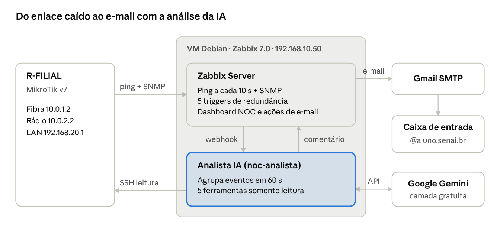

# NOC SENAI — Zabbix + Analista IA: Documentação Técnica

Oct 3, 2026 · @Matheus

## 1. Visão geral

O NOC do TCC monitora a redundância Fibra/Rádio entre Matriz e Filial e avisa por e-mail, em menos de 2 minutos, quando um enlace cai, com um relatório de causa provável escrito por IA. Tudo roda em uma VM Debian com Zabbix 7.0 dentro do notebook, ligada ao switch da Matriz.

O que foi construído:

- **Monitoramento:** o roteador R-FILIAL é coletado por SNMP e cada enlace (fibra e rádio) é testado por ping a cada 10 segundos.
- **Detecção de failover:** 9 triggers distinguem fibra caída com rádio assumindo, rádio caído, Filial isolada, failover lento e fibra instável, e avisam antes da queda quando o rádio começa a degradar. O tempo de cada failover é medido em segundos.
- **Dashboard NOC:** estado dos enlaces em tempo real, latência, problemas ativos e histórico de notificações, no Zabbix e no Grafana (tela escura para a TV do NOC, com o caminho ativo Fibra/Rádio em destaque).
- **E-mail:** alerta na abertura e na normalização de cada problema, via Gmail.
- **Analista NOC com IA:** ao abrir um problema, uma IA (Google Gemini, gratuito) investiga o Zabbix e o MikroTik com ferramentas somente leitura e envia um relatório com linha do tempo, causa provável, impacto e ações recomendadas.



O Zabbix detecta a queda e manda o alerta direto ao Gmail; em paralelo, chama o Analista IA, que investiga (Zabbix, Gemini e SSH no roteador) e devolve um comentário ao evento, que vira o segundo e-mail.

Status em 03/10/2026: servidor, dashboard, e-mail e IA testados de ponta a ponta. Falta apenas a montagem física da bancada (MikroTiks e enlaces).

Este ambiente é um **protótipo** numa VM do notebook. Na topologia real, o Zabbix e todos os serviços deste documento vão rodar num **servidor dedicado**, reinstalados a partir do repositório do GitHub.

## 2. Topologia monitorada

A Matriz e a Filial se ligam por dois enlaces com OSPF: a fibra (custo 10) carrega o tráfego e o rádio (custo 100) só assume quando a fibra cai. A rede não tem saída para a internet.

| Equipamento | Função | Endereços |
| --- | --- | --- |
| R-MATRIZ (MikroTik RouterOS v7) | Gateway da Matriz, OSPF router-id 1.1.1.1 | LAN 192.168.10.1/24 · Fibra 10.0.1.1/30 · Rádio 10.0.2.1/29 |
| R-FILIAL (MikroTik RouterOS v7) | Gateway da Filial, OSPF router-id 2.2.2.2 — **host monitorado** | LAN 192.168.20.1/24 · Fibra 10.0.1.2/30 · Rádio 10.0.2.2/29 |
| SW-MATRIZ / SW-FILIAL | Switches L2 de acesso | 192.168.10.2 / 192.168.20.2 (se gerenciáveis) |
| RADIO-P2P-MATRIZ / FILIAL | Ponte L2 transparente do enlace de backup | 10.0.2.3 / 10.0.2.4 |
| Servidor Zabbix (VM) | Monitoramento + Analista IA, ligado ao SW-MATRIZ | 192.168.10.50/24 |

Portas nos roteadores (revisão CTI, 14/10/2026): `ether1-WAN-RADIO` (rádio), `sfp1-WAN-FIBRA` (fibra óptica, módulo SFP; a ether2 fica de reserva) e `ether3`, `ether4`, `ether5` na `bridge-LAN` (rede local), todas com MTU 2000. Cada roteador tem uma **loopback /32** (R-MATRIZ `10.255.255.1`, R-FILIAL `10.255.255.2`), anunciada no OSPF e usada como router-id.

Por que o Zabbix fica na Matriz: ele mede cada enlace pingando o IP da Filial **daquele** enlace (10.0.1.2 pela fibra, 10.0.2.2 pelo rádio). Assim, ele enxerga exatamente qual caminho caiu, enquanto a coleta SNMP usa a LAN da Filial (192.168.20.1), alcançável por qualquer um dos dois.

## 3. Servidor Zabbix

O Zabbix 7.0.31 roda em uma VM Debian 12 no VMware do notebook, com duas placas de rede: uma na rede da Matriz para monitorar e outra em NAT para ter internet (e-mail e IA). As duas redes nunca se misturam.

| Item | Valor |
| --- | --- |
| Sistema | Debian 12 (bookworm), Python 3.11 |
| Pacotes | Zabbix Server 7.0 LTS + frontend PHP + Apache + MariaDB + zabbix-agent2 |
| Interface web | `http://192.168.137.50/zabbix` (do notebook, sempre) · `http://192.168.10.50/zabbix` (da rede da Matriz) |
| SSH | `root@192.168.137.50` por chave (`id_ed25519_zabbix` no notebook) |
| Banco | MariaDB, base `zabbix`, utf8mb4 |

Recursos da VM após a ampliação de 03/10/2026: 4 GB de RAM, 1 vCPU, disco de 20 GB (cerca de 48% em uso) e swap de 2 GB em arquivo (`/swapfile`). A tabela de partições anterior está salva em `/root/sda-particoes-antes.sfdisk`. Na mesma VM roda o Grafana 13.2 em `http://192.168.137.50:3000` (seção 5).

### Rede da VM

| Placa | Modo VMware | Perfil NetworkManager | Endereço | Uso |
| --- | --- | --- | --- | --- |
| ens33 | Bridge na placa Killer E2600 (cabo) | `NOC-Matriz-Estatico` | 192.168.10.50/24, sem gateway | Rotas 192.168.20.0/24 e 10.0.0.0/8 via 192.168.10.1 |
| ens35 | NAT (VMnet8) | `NAT-Internet` | 192.168.137.50/24, gateway e DNS 192.168.137.2 | Internet pelo Wi-Fi do notebook |

Cuidado: no **Virtual Network Editor** do VMware, o VMnet0 deve estar preso à placa Killer (cabo), não em "Automatic". Em automático, o bridge pode cair no Wi-Fi e a VM perde a rede da Matriz.

### Instalação (resumo)

1. Repositório oficial `zabbix-release_latest_7.0+debian12_all.deb` e pacotes `zabbix-server-mysql zabbix-frontend-php zabbix-apache-conf zabbix-sql-scripts zabbix-agent2`.
2. Banco `zabbix` (utf8mb4\_bin) com usuário próprio e importação de `server.sql.gz`.
3. `DBPassword` em `/etc/zabbix/zabbix_server.conf` e assistente web concluído.
4. Toda a configuração seguinte foi feita pela API (scripts Python em `/root/noc`), sem cliques no navegador.

## 4. Monitoramento do R-FILIAL

O host R-FILIAL está no grupo **Rede SENAI - Equipamentos**, é coletado por SNMP v2c pela loopback `10.255.255.2:161 (loopback)` (comunidade na macro `{$SNMP_COMMUNITY}` = `public_senai`) e usa o template oficial **Mikrotik by SNMP**, que descobre sozinho interfaces, CPU, memória, temperatura e inclui ping ICMP.

### Itens de enlace (criados no host)

Esses itens não dependem do SNMP: funcionam assim que os enlaces tiverem IP, coletando a cada 10 s e guardando 90 dias de histórico.

| Item | Chave | Significado |
| --- | --- | --- |
| Caminho ativo Matriz-Filial | `noc.caminho_ativo` (calculado: fibra × 2 + rádio) | 3 ou 2 = FIBRA, 1 = RÁDIO (failover), 0 = FILIAL ISOLADA |
| Enlace FIBRA - estado (R-FILIAL ether2) | `icmpping[10.0.1.2,3,,,500]` | 1 = UP, 0 = DOWN (mapa "Estado do Enlace") |
| Enlace RÁDIO - estado (R-FILIAL ether1) | `icmpping[10.0.2.2,3,,,500]` | 1 = UP, 0 = DOWN |
| Enlace FIBRA - latência | `icmppingsec[10.0.1.2,3,,,500]` | Tempo de resposta em segundos (0 = sem resposta) |
| Enlace RÁDIO - latência | `icmppingsec[10.0.2.2,3,,,500]` | Tempo de resposta em segundos |
| Enlace FIBRA / RÁDIO - perda de pacotes | `icmppingloss[10.0.1.2,...]` / `icmppingloss[10.0.2.2,...]` | % de pacotes perdidos, base da previsão de degradação |
| Alcance LAN Filial (1s) | `icmpping[192.168.20.1,1,,,300]`, a cada **1 s** | Mede o tempo real sem comunicação durante uma troca de enlace |
| Tempo de failover medido | `noc.failover.segundos` (trapper) | Segundos de interrupção em cada queda da fibra, gravado por `failover_registro.py` |

### Triggers de redundância

Um enlace só é considerado DOWN após 2 medições seguidas sem resposta (cerca de 20 s), o que evita alarme por um pacote perdido.

| Severidade | Trigger | Condição |
| --- | --- | --- |
| Desastre | FILIAL ISOLADA: Fibra e Rádio indisponíveis | Os dois enlaces DOWN |
| Alta | Link FIBRA caiu: failover para RÁDIO ativo | Fibra DOWN e rádio UP |
| Média | Link RÁDIO (backup) caiu: rede sem redundância | Rádio DOWN e fibra UP |
| Média | Filial sem comunicação há mais de 10s (failover lento ou queda) | LAN da Filial sem resposta por 10 s seguidos |
| Média | RÁDIO com perda de pacotes (>5% por 5min) | Rádio UP, mas perdendo pacotes |
| Aviso | Link FIBRA instável: 3+ quedas na última hora | 6 ou mais mudanças de estado da fibra em 1 h |
| Aviso | Latência alta no RÁDIO (>50ms por 5min) | Latência mínima do rádio acima de 50 ms por 5 min |
| Aviso | PREVISÃO: latência do RÁDIO deve passar de 50ms em 30min | `forecast()` da última hora prevê mais de 50 ms em 30 min, ainda abaixo disso agora |
| Aviso | RÁDIO acima do normal: latência 2x maior que a média de 24h | Média de 15 min acima do dobro da média de 24 h |

Os três últimos avisam **antes** da queda do rádio: ele ainda funciona, mas está piorando. Isso dá tempo de verificar alinhamento e interferência enquanto a fibra ainda está de pé.

### Manutenção automática da bancada

Enquanto a rede não está montada, o host fica na manutenção **Montagem da bancada - TCC**: o Zabbix continua coletando, mas não envia e-mails. Um cron (`/etc/cron.d/noc-fim-manutencao`) verifica a cada minuto e encerra a manutenção sozinho assim que a fibra ou o rádio responderem.

## 5. Dashboard NOC

O dashboard **NOC - Monitoramento de Redundância (OFICIAL)** tem 3 páginas (redundância, saúde do R-FILIAL e mapa da topologia) que se alternam sozinhas a cada 30 s, pensado para ficar aberto numa TV durante a apresentação. Ele é montado pelo script `dash_noc.py`.

### Página 1 — Redundância Fibra x Rádio

| Linha | Widgets | Para que serve |
| --- | --- | --- |
| 1 | CAMINHO ATIVO, FIBRA (principal), RÁDIO (backup), Latência FIBRA, Latência RÁDIO, Problemas por severidade | Estado em 2 segundos: verde = UP, vermelho = DOWN; latência verde até 20 ms, amarela até 50 ms, vermelha acima |
| 2 | Linha do tempo dos enlaces (degraus 1/0) e Latência FIBRA x RÁDIO | Mostra quando cada enlace caiu e voltou e quanto tempo durou o failover |
| 3 | Tráfego FIBRA (ether2) x RÁDIO (ether1) | No failover o tráfego some da linha azul e aparece na laranja: a prova visual de que a redundância funcionou |
| 4 | Problemas ativos (com linha do tempo) e Análises da IA enviadas por e-mail | O que está acontecendo agora e o que a IA concluiu |

### Página 2 — Saúde do R-FILIAL

Disponibilidade SNMP/ICMP, relógio, todas as notificações enviadas, CPU, memória, temperatura e tráfego de todas as interfaces.

Os gráficos de tráfego, CPU, memória e temperatura usam padrões de nome (ex.: `*ether2*Bits*`). Eles ficam vazios até o SNMP responder e se preenchem sozinhos depois que o template descobrir as interfaces, sem nenhuma edição.

Dica para a apresentação: o botão de tela cheia (modo quiosque) no canto superior direito do dashboard esconde os menus do Zabbix.

### Grafana — a tela da TV do NOC

O Grafana 13.2 com o plugin oficial do Zabbix (6.8.0) mostra o painel **NOC - Redundância Fibra x Rádio** em `http://192.168.137.50:3000`, com tema escuro e atualização a cada 10 s. Ele só lê dados: coleta, alertas, e-mail e IA continuam no Zabbix.

| Painel | O que mostra |
| --- | --- |
| Caminho ativo Matriz ↔ Filial | FIBRA (verde), RÁDIO (failover, laranja) ou FILIAL ISOLADA (vermelho), lido do item calculado do Zabbix |
| FIBRA / RÁDIO | UP ou DOWN com fundo verde ou vermelho |
| Latência FIBRA / RÁDIO | Tempo de resposta, ou "sem resposta" quando o enlace está fora |
| Linha do tempo dos enlaces | Faixas UP/DOWN ao longo do tempo: cada troca de cor é uma queda ou um retorno |
| Latência Fibra x Rádio e Tráfego ether2 x ether1 | Gráficos; no failover o tráfego sai da linha da fibra e aparece na do rádio |
| Problemas | Lista de problemas do grupo, com os comentários da IA |

Como usar:

- **TV do NOC:** abrir `http://192.168.137.50:3000/d/noc-redundancia?kiosk`. O acesso de visitante é somente leitura e não pede login.
- **Administração:** usuário `admin`; a senha aleatória está na VM, em `/root/.grafana_admin`.
- **Conexão com o Zabbix:** fonte de dados "Zabbix NOC" com o usuário `grafana-leitura` (somente leitura, token próprio).
- **Configuração:** tudo por provisionamento (`setup_grafana.py`); para mudar o painel, edite o script e rode-o de novo. Para conferir, rode `testar_grafana.py`.

Verificado em 03/10/2026: todos os painéis de dados respondem e o painel mostra corretamente FILIAL ISOLADA com a bancada desmontada. O gráfico de tráfego só terá dados depois que o SNMP do MikroTik responder.

### Mapa da topologia (página 3 do dashboard do Zabbix)

O mapa **Topologia NOC SENAI - Fibra x Rádio** desenha Matriz (zona azul) e Filial (zona verde) sobre um fundo próprio, com ícones arredondados em tons pastel gerados por mapa\_visual.py: a fibra em linha direta e o rádio passando pelas duas antenas, com o trecho sem fio tracejado. Cada enlace muda de cor sozinho: verde = normal, vermelho = caído, laranja = perda de pacotes ou instável, amarelo = previsão de degradação. O R-FILIAL troca para o ícone vermelho quando tem problema. A latência não aparece no mapa, porque o Zabbix 7.0 não renderiza expressões com conta nos rótulos; ela está no dashboard e no Grafana. Criado por `mapa_topologia.py`.

### Página de status para os usuários da Filial

Uma página simples, sem termos técnicos, em `http://192.168.10.50/status` (rede da empresa) e `http://192.168.137.50/status` (notebook), atualizada a cada minuto por `status_page.py` (cron) e servida pelo Apache.

- **Situação agora:** "Funcionando normalmente", "Funcionando pelo link reserva" ou "Sem conexão com a Matriz".
- **Disponibilidade:** percentual das últimas 24 h e 7 dias, com uma barra colorida por dia.
- **Ocorrências dos últimos 7 dias** em linguagem simples, com duração.
- **Último failover:** quantos segundos os usuários ficaram sem conexão na última troca automática.
- Enquanto o host estiver em manutenção, uma faixa avisa que o ambiente está em implantação.

## 6. Notificações por e-mail

Cada problema do grupo gera até três e-mails para `matheus.ziravello@aluno.senai.br`: o alerta na abertura, a análise da IA cerca de 1 minuto depois e a normalização quando resolve. Os três foram recebidos no teste de 03/10/2026; aparecem com remetente "eu" porque saem da própria conta.

### Tipo de mídia "Gmail Alertas SENAI"

| Campo | Valor |
| --- | --- |
| Servidor SMTP | `smtp.gmail.com`, porta 587, STARTTLS |
| Conta e remetente | `matheus.ziravello@aluno.senai.br` |
| Autenticação | Senha de app do Google (a conta tem verificação em duas etapas; a senha normal é recusada com erro 534) |
| Formato | HTML |
| Destinatário | Mídia do usuário Admin, todas as severidades, 24x7 |

### Ações

| Ação | Estado | O que faz |
| --- | --- | --- |
| Notificação NOC - Redundância e Enlaces | Ativa | Alerta "\[ALERTA NOC SENAI\]" na abertura e "\[NORMALIZADO NOC SENAI\]" na recuperação, para o grupo Rede SENAI - Equipamentos |
| Analista IA - Investigação de incidentes | Ativa | Chama o Analista IA na abertura; quando a IA comenta o evento, envia o comentário por e-mail como "\[ANÁLISE IA\]" |
| Notificação de Redundância - Link Fibra/Rádio | Desativada | Duplicada e sem filtro: mandava cada alerta duas vezes e incluía alertas do próprio Zabbix server |

Problemas suprimidos por manutenção não geram e-mail (opção "pausar operações para problemas suprimidos").

Dica: no Gmail, um filtro com assunto `NOC SENAI` que aplica o marcador "NOC" e marca como importante deixa os alertas fáceis de achar na apresentação.

## 7. Analista NOC com IA

O Analista IA é um serviço Python na VM (`noc-analista`) que recebe cada problema novo do Zabbix, investiga sozinho com ferramentas somente leitura e publica um relatório em cerca de 20 s. Ele usa o Google Gemini na camada gratuita, sem custo.

### Fluxo de um incidente

1. O Zabbix abre o problema e a ação "Analista IA" chama o webhook `Analista IA`, que faz `POST http://127.0.0.1:8765/evento`.
2. O serviço espera **60 s** juntando os eventos do mesmo host (ex.: "fibra caiu" + "ether2 link down" viram um incidente só).
3. A IA recebe a lista de eventos, a topologia e as regras de interpretação, e chama as ferramentas que achar necessárias.
4. O relatório vira um comentário no evento, assinado pelo usuário `noc-analista`, e fica salvo em `/var/lib/noc-analista/`.
5. O comentário dispara a operação de atualização da ação, que envia o e-mail "\[ANÁLISE IA\]".

O comentário usa um usuário próprio porque o Zabbix não notifica o autor de uma atualização sobre ela mesma: comentando como Admin, o e-mail para o Admin nunca sairia.

### Ferramentas da IA (somente leitura)

| Ferramenta | O que devolve |
| --- | --- |
| `estado_atual` | Disponibilidade SNMP, caminho ativo, estado e latência de cada enlace, problemas ativos |
| `historico_item` | Mudanças UP/DOWN com horário, ou mínimo/média/máximo de uma métrica |
| `eventos_recentes` | Problemas das últimas horas com duração (detecta link instável) |
| `listar_itens` | O que o Zabbix coleta do host (tráfego, CPU, interfaces) |
| `medir_failover` | Para cada queda e retorno da fibra, quantos segundos a LAN da Filial ficou sem resposta (ping a cada 1 s) |
| `consultar_mikrotik` | SSH no R-FILIAL com usuário `zabbix-ia` (grupo read): interfaces, erros Ethernet, vizinhos OSPF, rotas, log, recursos. Lista fixa de comandos |

O cálculo do `medir_failover` foi validado com dados simulados: uma queda com 6 s de interrupção foi medida como 6 s, e um retorno sem perda como "troca transparente".

### Provedor de IA

| Provedor | Quando é usado | Custo |
| --- | --- | --- |
| Google Gemini (`gemini-3.5-flash`, depois `gemini-flash-latest`, depois `gemini-flash-lite-latest`) | Padrão, chave em `/root/.gemini_key` | Gratuito (o Google pode usar os dados enviados para melhorar modelos) |
| Anthropic Claude (`claude-opus-5-5`) | Só se existir `/root/.anthropic_key`; tem prioridade | Pago por uso |

A camada gratuita do Gemini responde "503 alta demanda" com frequência. O serviço tenta cada modelo duas vezes e passa para o próximo; no teste real isso aconteceu e a análise saiu normalmente.

### Proteções

- **Custo e ruído:** o mesmo problema não é reanalisado antes de 15 min, e há no máximo 12 análises por hora.
- **Somente leitura:** nenhuma ferramenta altera o Zabbix ou o roteador.
- **Sem loop:** atualizações e recuperações são ignoradas, então o próprio comentário da IA não dispara nova análise.
- **Honestidade:** a IA é instruída a afirmar só o que os dados mostram, a dizer qual dado faltou e a dar confiança alta apenas quando a evidência aponta para uma única causa.

### Exemplo real (03/10/2026, bancada desmontada)

Gerado pelo `gemini-3.5-flash` em 17 s, após 8 consultas às ferramentas. Trecho:

```text
RESUMO: O roteador R-FILIAL está completamente isolado, com ambos os enlaces
(Fibra e Rádio) indisponíveis. O host está marcado como em manutenção no Zabbix.

LINHA DO TEMPO:
- 10:20:41  Ambos os enlaces já estavam DOWN desde o início da medição.
- 10:21:32  Alerta de indisponibilidade por ICMP ping é ativado.

CAUSA PROVÁVEL: Manutenção programada ou intervenção física no local
(confiança média). [...] o Zabbix perdeu toda a visibilidade da Filial,
impossibilitando distinguir remotamente se o equipamento está sem energia,
se foi desligado ou se houve falha física simultânea.

AÇÕES RECOMENDADAS:
1. Confirmar se há manutenção ativa ou se o R-FILIAL está em bancada.
2. Verificar presencialmente se o roteador está ligado e recebendo energia.
3. Checar os LEDs das portas ether2 (Fibra) e ether3 (Rádio).
```

A causa apontada (equipamento em bancada) era a verdadeira. Duas falhas da primeira versão foram corrigidas antes deste resultado: a IA afirmava que a fibra "caiu" no horário em que a medição apenas começou, e dava confiança alta para três causas alternativas. Os relatórios de failover real (fibra cai, rádio assume) só poderão ser avaliados com a bancada montada.

## 8. Segurança

Cada componente tem só a permissão de que precisa, e nenhuma senha ou chave fica escrita nos scripts: todas ficam em arquivos `chmod 600` lidos só pelo root.

| Credencial | Onde fica | Quem usa |
| --- | --- | --- |
| Token da API do Zabbix (Admin) | `/root/.zabbix_token` | Scripts de configuração e ferramentas da IA |
| Token do usuário `noc-analista` | `/root/.zabbix_token_analista` | Só para comentar eventos |
| Chave do Gemini | `/root/.gemini_key` | Analista IA |
| Chave SSH do analista | `/root/.ssh/id_ed25519_mikrotik` | Consultas de leitura no R-FILIAL |
| Senha de app do Gmail | Dentro da mídia do Zabbix (banco) | Envio de e-mail |
| Acesso SSH à VM | Chave `id_ed25519_zabbix` no notebook | Administração |

Medidas aplicadas:

- **Usuário `noc-analista` no Zabbix:** papel "User", grupo "NOC Automação" sem acesso ao frontend, leitura só no grupo Rede SENAI - Equipamentos.
- **Usuário `zabbix-ia` no MikroTik:** grupo `read`, login só por chave, e a IA executa apenas uma lista fixa de 6 comandos de consulta.
- **SNMP:** v2c somente leitura, aceito apenas do IP do Zabbix (192.168.10.50); a comunidade padrão `public` é desativada.
- **Firewall do R-FILIAL:** SNMP (UDP 161) e SSH (TCP 22) liberados só para o Zabbix, antes do drop final.
- **Serviço do analista:** ouve apenas em `127.0.0.1:8765`, inacessível pela rede.
- **Scripts antigos:** movidos para `/root/scripts-antigos/` com as senhas removidas.

Pendências recomendadas:

- [ ] Revogar a senha de app do Gmail que foi exposta em chat e gerar uma nova
- [ ] Trocar a senha pessoal do Gmail que também foi exposta
- [ ] Trocar a senha padrão do usuário Admin do Zabbix
- [ ] Trocar `TROQUE_POR_UMA_SENHA_FORTE` no script do R-FILIAL antes de colar

### Servidor à prova de falhas (05/10/2026)

| Medida | Como funciona | Arquivo |
| --- | --- | --- |
| HTTPS em tudo | Zabbix, página de status (Apache, porta 443) e Grafana (porta 3000) usam um certificado assinado pela **CA própria do NOC**, válido para `192.168.137.50`, `192.168.10.50` e `noc.senai.local`. Acessos por `http://` de fora são redirecionados para `https://`; os scripts internos continuam usando `http://localhost` | `setup_https.sh` |
| Certificado da CA no navegador | Instale `NOC-SENAI-CA.crt` no Windows (abaixo) e o navegador mostra o cadeado sem aviso. Também disponível em `http://192.168.137.50/NOC-SENAI-CA.crt` e na pasta `certificado/` do GitHub | `certificado/NOC-SENAI-CA.crt` |
| Backup diário | Todo dia às 02:30: dump do banco do Zabbix + configurações (Zabbix, Grafana, Apache, scripts, CA, cron, serviço, credenciais) em `/var/backups/noc`, guardando 7 dias, só o root lê. Primeiro backup: 5 MB, dump verificado íntegro | `backup_noc.sh` |
| Alerta de backup | Item "Backup NOC - tamanho total" no host *Zabbix server*; se o backup não rodar em 26 h, abre o problema "Backup diário do NOC não rodou nas últimas 26h" | `setup_backup.py` |
| Snapshot da VM | Snapshot `estavel-2026-10-05-https-backup` no VMware: em caso de problema, *VM > Snapshot > Revert* volta a este estado em 1 minuto | VMware |
| Placa de rede estável | A placa NAT usava o modelo antigo AMD PCnet32, que oscilou 6 vezes e travou a VM em 05/10. Trocada para Intel e1000 (`ethernet1.virtualDev = "e1000"`); cópia do original em `Debian2.vmx.antes-e1000` | `Debian2.vmx` |

**Instalar o certificado da CA no Windows** (uma vez, você mesmo): dê dois cliques em `NOC-SENAI-CA.crt` > *Instalar Certificado* > *Usuário Atual* > *Colocar todos os certificados no repositório a seguir* > *Autoridades de Certificação Raiz Confiáveis* > Concluir. Feche e abra o navegador. O Firefox usa um repositório próprio: *Configurações > Privacidade e Segurança > Certificados > Ver certificados > Autoridades > Importar*.

Para restaurar um backup do banco: `zcat /var/backups/noc/zabbix-banco-<data>.sql.gz | mysql zabbix` com o `zabbix-server` parado.

## 9. Dia da montagem

No Zabbix nada precisa ser mexido: com a rede montada e o script abaixo colado no R-FILIAL, os enlaces ficam verdes em até 1 minuto e a manutenção se encerra sozinha.

### Montagem automática (pasta `bancada/` do repositório)

Quase tudo se configura por script; só os rádios P2P são manuais, pela página web do fabricante. O passo a passo completo está em `bancada/LEIA-ME.md`.

| Passo | Comando (no notebook, salvo indicação) | O que faz |
| --- | --- | --- |
| 1 | `python bancada\gerar_configs.py` | Pergunta as senhas sem mostrar na tela e gera em `bancada\saida\` os arquivos finais: R-MATRIZ, R-FILIAL (com o bloco do NOC), switches, scripts dos PCs e a ficha dos rádios |
| 2 | `bancada\enviar_mikrotik.ps1 -Equipamento R-MATRIZ` (depois `R-FILIAL`) | Copia o arquivo para o MikroTik de fábrica (192.168.88.1); ele apaga a configuração, reinicia e se configura sozinho (`run-after-reset`) em cerca de 1 minuto |
| 3 | Página web de cada rádio | Valores de `saida\RADIOS.txt` |
| 4 | `pc-matriz.ps1` / `pc-filial.ps1`, como administrador, em cada PC | IP fixo, gateway, MTU 2000 e resposta a ping |
| 5 | Na VM: `/opt/noc-analista/bin/python validar_bancada.py` | 14 verificações (rede, enlaces, antenas, Filial, SNMP, SSH de leitura, OSPF, rota pela fibra, MTU 2000 entre roteadores, o que o Zabbix vê), com dica para cada falha |

Os arquivos de `bancada\saida\` contêm as senhas digitadas: ficam fora do Git e devem ser apagados após a configuração. Testado em 05/10/2026 sem os equipamentos: o gerador produz os arquivos corretos e a validação aponta as 13 falhas esperadas com a rede desmontada; o envio ao MikroTik e o `run-after-reset` só poderão ser testados com os roteadores.

### Checklist

- [ ] Colar os scripts principais do R-MATRIZ e do R-FILIAL (documento da topologia)
- [ ] Colar no R-FILIAL o bloco de integração com o NOC (abaixo), com a senha trocada
- [ ] Ligar o cabo do notebook no SW-MATRIZ, com o Wi-Fi conectado à internet
- [ ] Conferir no VMware que o VMnet0 está preso à placa Killer (cabo)
- [ ] No Debian: `ping 192.168.10.1`, `ping 10.0.1.2` e `ping 10.0.2.2` respondem
- [ ] No Debian: `snmpget -v2c -c public_senai 192.168.20.1 1.3.6.1.2.1.1.5.0` devolve `R-FILIAL`
- [ ] Dashboard: FIBRA e RÁDIO verdes, disponibilidade SNMP verde
- [ ] Rodar o roteiro de testes de failover

### Bloco de integração para o R-FILIAL

Arquivo `routeros-r-filial-noc.rsc`. O `security=none` é obrigatório no SNMP v2c: o `security=private` dos scripts antigos exigia SNMPv3 e o Zabbix nunca conseguiria ler o roteador.

```text
/snmp community set [find default=yes] disabled=yes
/snmp community add name=public_senai addresses=192.168.10.50/32 security=none read-access=yes write-access=no
/snmp set enabled=yes contact="NOC SENAI TCC" location="Rack Filial"
/ip firewall filter add chain=input action=accept protocol=udp dst-port=161 src-address=192.168.10.50 comment="NOC: Zabbix SNMP"
/ip firewall filter add chain=input action=accept protocol=tcp dst-port=22 src-address=192.168.10.50 comment="NOC: Analista IA SSH (leitura)"
/ip firewall filter move [find comment="NOC: Zabbix SNMP"] destination=0
/ip firewall filter move [find comment="NOC: Analista IA SSH (leitura)"] destination=1
/user add name=zabbix-ia group=read password="TROQUE_POR_UMA_SENHA_FORTE" comment="Analista IA - somente leitura"
/user ssh-keys add user=zabbix-ia key="ssh-ed25519 AAAAC3NzaC1lZDI1NTE5AAAAIJ6p8g/oAtn3KK0x8Tze43LoZ5JZ6vePhG3ihVcCquum noc-analista@zabbix"
```

Correção de 05/10/2026: a versão anterior usava a variável `:local ZABBIX`, que se perde entre linhas coladas no terminal do RouterOS e deixaria SNMP e SSH liberados para ninguém. Agora o IP vai escrito em cada linha.

A sintaxe `ssh-keys add ... key=` não foi confirmada na versão do RouterOS da bancada. Se der erro, a alternativa é enviar o arquivo `.pub` ao roteador e usar `/user ssh-keys import`.

### Roteiro de testes de failover

| Teste | Comando no R-FILIAL | Resultado esperado |
| --- | --- | --- |
| 1. Queda da fibra | `/interface disable sfp1-WAN-FIBRA` | Em \~20 s: FIBRA vermelho, trigger "Link FIBRA caiu: failover para RÁDIO ativo", e-mail de alerta; em \~1 min: e-mail "\[ANÁLISE IA\]" confirmando o failover e o tempo medido em segundos |
| 2. Volta da fibra | `/interface enable sfp1-WAN-FIBRA` | FIBRA verde, e-mail "\[NORMALIZADO NOC SENAI\]" |
| 3. Queda do rádio | `/interface disable ether1-WAN-RADIO` | Trigger "rede sem redundância" (Média), alerta e análise |
| 4. Fibra instável | Desligar e religar a sfp1 3 vezes em poucos minutos | Trigger "Link FIBRA instável"; a IA deve apontar problema físico |
| 5. Filial isolada | Desligar sfp1 e ether1 | Trigger de Desastre; a IA deve dizer que perdeu a visibilidade e listar verificações físicas |

O mesmo problema só é reanalisado pela IA após 15 min. Para repetir um teste antes disso, rode `systemctl restart noc-analista` na VM.

## 10. Operação e solução de problemas

Quase todo problema se diagnostica com três comandos na VM: o estado dos serviços, o log do analista e o log do Zabbix.

### Comandos úteis (na VM, como root)

| Para | Comando |
| --- | --- |
| Ver se tudo está rodando | `systemctl status zabbix-server apache2 mariadb noc-analista` |
| Saúde e provedor do analista | `curl -s localhost:8765/saude` |
| Log do analista em tempo real | `journalctl -u noc-analista -f` |
| Log do Zabbix server | `tail -f /var/log/zabbix/zabbix_server.log` |
| Relatórios da IA já gerados | `ls -lt /var/lib/noc-analista/` |
| Analisar o problema ativo agora, sem enviar | `cd /root/noc && /opt/noc-analista/bin/python analista.py --simular` |
| O mesmo, comentando e enviando e-mail | `... analista.py --simular --publicar` |
| Testar o fluxo inteiro até o e-mail (sem IA) | `touch /root/noc/MODO_TESTE && systemctl restart noc-analista && /opt/noc-analista/bin/python teste_integracao.py; rm /root/noc/MODO_TESTE && systemctl restart noc-analista` |
| Testar as ferramentas da IA | `/opt/noc-analista/bin/python testar_ferramentas.py` |
| Ver rede da VM | `ip -4 -br a` e `nmcli con show` |

### Erros comuns

| Sintoma | Causa provável | Correção |
| --- | --- | --- |
| SNMP vermelho, mas os enlaces respondem ping | Comunidade, `security=private` ou firewall do R-FILIAL | Conferir o bloco de integração (seção 9) e testar com `snmpget` |
| Enlaces DOWN com tudo ligado | VM sem rota ou bridge no Wi-Fi | `ip route` deve mostrar 10.0.0.0/8 e 192.168.20.0/24 via 192.168.10.1; conferir VMnet0 |
| Nenhum e-mail chega | Host em manutenção ou senha de app revogada | Em Reports > Action log, ver o status do alerta; erro 534 = gerar nova senha de app |
| Alerta chega, análise IA não | Gemini indisponível, chave ausente ou cooldown de 15 min | `journalctl -u noc-analista -n 50`; "todos os modelos indisponíveis" = tentar mais tarde |
| Análise IA chega cortada | Comentário do Zabbix limitado a 2048 caracteres | Relatório completo em `/var/lib/noc-analista/` |
| Após um `apt upgrade` a sessão SSH caiu | Serviços de rede reiniciados | Rodar upgrades dentro de `tmux` ou `screen` |

### Quando o modelo do Gemini sair do ar

O Google retira versões antigas (o `gemini-2.5-flash` já não existe para contas novas). Se todos os modelos da lista falharem com erro 404, edite `MODELOS` em `/root/noc/provedor_gemini.py` com um nome atual e rode `systemctl restart noc-analista`.

## 11. Arquivos e scripts

O código-fonte fica na pasta `Documents\Claude\noc-analista` do notebook, com cópia em execução na VM em `/root/noc`. Todos os scripts de configuração podem ser rodados de novo sem duplicar nada.

| Arquivo | Função |
| --- | --- |
| `zbx.py` | Cliente da API do Zabbix (token Admin e token do analista) |
| `fix_redundancia.py` | Host na LAN, template MikroTik, itens de enlace, caminho ativo, alcance 1 s, perdas, triggers de queda e de previsão, manutenção |
| `dash_enlaces.py` / `dash_noc.py` | Dashboard NOC do Zabbix (3 páginas) |
| `mapa_topologia.py` | Mapa da topologia com enlaces coloridos por trigger |
| `setup_grafana.py` / `testar_grafana.py` | Configuração completa do Grafana e teste dos painéis |
| `status_page.py` | Página de status para os usuários (cron a cada minuto) |
| `failover_registro.py` | Grava o tempo de cada failover no item `noc.failover.segundos` (cron a cada minuto) |
| `auto_fim_manutencao.py` | Encerra a manutenção quando um enlace responde (cron a cada minuto) |
| `setup_zabbix_analista.py` | Webhook, ação "Analista IA", usuário `noc-analista` e seu token |
| `analista.py` | Serviço do Analista IA: recebe, agrupa, investiga, publica |
| `ferramentas.py` | As 6 ferramentas somente leitura da IA |
| `provedor_gemini.py` / `provedor_teste.py` | Provedor Gemini gratuito e provedor de teste sem IA |
| `testar_ferramentas.py` / `teste_integracao.py` | Testes das ferramentas e do fluxo completo até o e-mail |
| `noc-analista.service` | Unidade systemd (`/etc/systemd/system/`) |
| `routeros-r-filial-noc.rsc` | Bloco de integração para colar no R-FILIAL |

Na VM também ficam: o ambiente Python em `/opt/noc-analista` (SDKs `google-genai` e `anthropic`), os relatórios em `/var/lib/noc-analista/` e os scripts antigos, sem senhas, em `/root/scripts-antigos/`.

### Instalador para o servidor dedicado

O NOC inteiro se instala num Debian 12 limpo com um comando, `bash instalar_noc.sh`, a partir do repositório. Testado em 05/10/2026 rodando sobre o próprio protótipo: as 10 etapas passaram, nada foi duplicado e Zabbix, Grafana, IA, página de status e tarefas agendadas continuaram funcionando. Ainda não foi testado num servidor totalmente vazio.

1. `git clone https://github.com/MathZiraA/noc-senai-tcc.git` e `cd noc-senai-tcc`.
2. `bash instalar_noc.sh`: na primeira vez ele cria `/etc/noc/noc.conf` e para.
3. Ajuste `/etc/noc/noc.conf`: `SERVIDOR_IP` (IP do servidor na LAN da Matriz) e, se mudarem, os IPs da rede e o e-mail.
4. `bash instalar_noc.sh` de novo. Ele pergunta, sem mostrar na tela, o token da API do Zabbix (explicando como criá-lo), a senha de app do Gmail e a chave do Gemini.
5. No fim, cole no R-FILIAL o arquivo `routeros-r-filial-noc.rsc` que ele gera, já com o IP do servidor.

| Etapa | O que faz |
| --- | --- |
| 1 | Lê `/etc/noc/noc.conf` e acerta o fuso horário |
| 2 | Pacotes do sistema e idioma pt-BR |
| 3 | Zabbix 7.0, banco com senha aleatória e configuração do site sem assistente web |
| 4 | Copia os scripts para `/root/noc` e cria o ambiente Python da IA |
| 5 | Grafana e HTTPS com a CA própria do NOC |
| 6 | Plugin do Zabbix no Grafana |
| 7 | Credenciais: token, senha de app, chave da IA |
| 8 | Configura o Zabbix pela API: host, itens, triggers, e-mail, analista, backup, mapa, dashboard |
| 9 | Grafana, serviço do analista, página de status e tarefas agendadas |
| 10 | Gera o bloco RouterOS com o IP do servidor |

Todos os endereços ficam em `/etc/noc/noc.conf` (modelo `noc.conf.exemplo`), lido por `config.py`; nenhum script tem IP fixo. Mudou um IP? Edite o arquivo e rode o instalador de novo: ele refaz o certificado HTTPS e reaplica a configuração.

## 12. Próximos passos: usos da IA e ideias de inovação

O Analista IA hoje cobre a análise de cada incidente; as listas abaixo são candidatas para expandir o projeto, não itens já implementados (exceto onde indicado).

### 20 usos da IA neste projeto

1. Análise de causa de cada incidente (implementado)
2. Medir o tempo de failover: quantos segundos o OSPF levou para passar o tráfego ao rádio (implementado)
3. Relatório semanal de disponibilidade: quanto cada enlace ficou no ar e quanto tempo a rede rodou pelo rádio
4. Detectar fibra instável e recomendar manutenção antes da queda definitiva
5. Prever falha do rádio percebendo a latência subindo aos poucos (implementado)
6. Auditoria diária da configuração: comparar o `/export` do MikroTik com a versão aprovada
7. Revisão de segurança do roteador: admin reativado, serviços abertos, regras de firewall fracas
8. Chat NOC: perguntas em português, como "quanto tempo ficamos no rádio hoje?"
9. Resumo de troca de plantão com o que aconteceu nas últimas 8 horas
10. Pós-incidente automático quando o problema resolve: duração, impacto e lições
11. Correlação de eventos num incidente só (implementado em parte, com a janela de 60 s)
12. Prioridade inteligente: tratar diferente o mesmo alerta em manutenção e em produção
13. Sugerir limites melhores para os triggers com base no histórico real
14. Documentação viva: inventário e plano de IPs gerados a partir dos dados coletados
15. Validação do MTU 2000 de ponta a ponta com teste guiado e laudo
16. Roteiro guiado de teste de failover para a banca, com laudo automático
17. Capacidade: avaliar se o rádio aguenta o tráfego que a fibra carrega
18. Explicar cada alerta em linguagem simples para técnicos iniciantes
19. Gerar o script de uma nova filial a partir do modelo, para revisão humana
20. Analisar os logs do MikroTik em busca de força bruta e comportamento estranho

### Ideias para inovar

- **Integração com o assistente de voz JARVIS:** "Jarvis, como está a rede?" e aviso falado quando a fibra cai.
- **Bot no Telegram ou WhatsApp** com botões "ver análise" e "reconhecer alerta".
- **Mapa da topologia no Zabbix ou no Grafana**, com os enlaces mudando de cor ao vivo (implementado no Zabbix).
- **Monitorar o R-MATRIZ e as duas antenas** para a IA distinguir defeito de antena de defeito de roteador.
- **Detecção instantânea:** o MikroTik avisa o Zabbix na hora da queda (SNMP trap ou netwatch), em vez de esperar o próximo ping.
- **Correção com aprovação humana:** a IA sugere um comando e um botão no e-mail autoriza a execução.
- **Página de status** para os usuários da Filial, como as empresas fazem (implementado).
- **Relatório mensal em PDF** gerado automaticamente para a gerência.
- **Backup das configurações em Git**, com a IA explicando o que mudou de um dia para o outro.
- **Experimento para o TCC:** comparar IA na nuvem (Gemini) e IA local (Ollama) em qualidade, tempo e custo.
- **Avaliação da IA:** botão "útil / não útil" em cada análise, gerando métricas de precisão para a monografia.
- **Testes de falha agendados:** derrubar a fibra de propósito toda semana, com aprovação, e medir se a redundância continua funcionando.

## 13. Guia de acesso: tudo o que existe e como acessar

Esta seção reúne, num lugar só, cada serviço, endereço, usuário e onde fica cada credencial em 03/10/2026. A coluna **Senha** está em branco de propósito: preencha você mesmo, se quiser, e nunca copie esta seção preenchida para o GitHub.

Desde 05/10/2026 todos os endereços web usam **https://** (ex.: `https://192.168.137.50/zabbix`, `https://192.168.137.50:3000`). Quem digitar `http://` é redirecionado; o Grafana só responde em `https://`.

### Endereços e acessos

Do notebook use sempre os endereços `192.168.137.x` (rede interna do VMware, funcionam com ou sem a bancada). Da rede da empresa (Matriz ou Filial) use `192.168.10.50`.

| O quê | Endereço | Usuário | Senha | Onde a senha está / como obter |
| --- | --- | --- | --- | --- |
| Zabbix (web) | `http://192.168.137.50/zabbix` · `http://192.168.10.50/zabbix` | `Admin` |  | A que você definiu; se nunca trocou, ainda é a padrão de instalação do Zabbix (trocar!) |
| Mapa da topologia | `http://192.168.137.50/zabbix/zabbix.php?action=map.view&sysmapid=5` | `Admin` |  | Mesma do Zabbix |
| Grafana — TV do NOC (sem login) | `http://192.168.137.50:3000/d/noc-redundancia?kiosk` | visitante | — | Somente leitura, não pede senha |
| Grafana — administração | `http://192.168.137.50:3000` | `admin` |  | Na VM: `cat /root/.grafana_admin` (gerada aleatoriamente) |
| Página de status | `http://192.168.137.50/status` · `http://192.168.10.50/status` | — | — | Pública na rede, sem login |
| VM — SSH | `ssh aluno@192.168.137.50` | `aluno` |  | Senha do usuário criada na instalação do Debian |
| VM — administrador | `su -` dentro da sessão SSH | `root` |  | Senha de root criada na instalação do Debian |
| VM — SSH por chave (sem senha) | `ssh -i ~/.ssh/id_ed25519_zabbix root@192.168.137.50` | `root` | — | Chave `id_ed25519_zabbix` na pasta `.ssh` do seu usuário no notebook |
| VM — console | Janela da VM no VMware Workstation | `aluno` / `root` |  | Mesmas senhas acima |
| Banco do Zabbix (MariaDB) | `localhost:3306`, base `zabbix` | `zabbix` |  | Na VM: `grep DBPassword /etc/zabbix/zabbix_server.conf` |
| R-MATRIZ (Winbox/SSH) | `192.168.10.1` | `admin_senai` |  | A definida no script `r-matriz.rsc` ao colar (`<SENHA_ADMIN_MATRIZ>`) |
| R-FILIAL (Winbox/SSH) | `192.168.20.1` | `admin_senai` |  | A definida no script `r-filial.rsc` ao colar (`<SENHA_ADMIN_FILIAL>`) |
| R-FILIAL — usuário da IA | `192.168.20.1` (SSH) | `zabbix-ia` (somente leitura) |  | Login por chave (`/root/.ssh/id_ed25519_mikrotik` na VM); senha = a que você colocar no lugar de `TROQUE_POR_UMA_SENHA_FORTE` |
| SW-MATRIZ / SW-FILIAL (se gerenciáveis) | `192.168.10.2` / `192.168.20.2` | `admin_senai` |  | Mesma do roteador do lado correspondente |
| Rádios P2P (interface web) | `http://10.0.2.3` (Matriz) / `http://10.0.2.4` (Filial) | conforme o fabricante |  | Definida na configuração web dos rádios |
| SNMP do R-FILIAL | `10.255.255.2:161 (loopback)`, v2c | comunidade `public_senai` | — | Macro `{$SNMP_COMMUNITY}` no host R-FILIAL |

### Credenciais guardadas na VM (todas `chmod 600`, só o root lê)

| Arquivo | O que é | Para que serve |
| --- | --- | --- |
| `/root/.zabbix_token` | Token da API do Zabbix do usuário Admin | Scripts de configuração e ferramentas da IA |
| `/root/.zabbix_token_analista` | Token do usuário `noc-analista` | Publicar o comentário da IA nos eventos |
| `/etc/grafana/provisioning/datasources/zabbix.yaml` | Token do usuário `grafana-leitura` | Grafana ler o Zabbix |
| `/root/.gemini_key` | Chave da API do Google Gemini | Analista IA |
| `/root/.grafana_admin` e `/etc/grafana/admin_password` | Senha do `admin` do Grafana | Login de administração |
| `/root/.ssh/id_ed25519_mikrotik` | Chave SSH do analista | Consultas de leitura no R-FILIAL |
| `/etc/zabbix/zabbix_server.conf` (`DBPassword`) | Senha do banco | Zabbix server falar com o MariaDB |
| Mídia "Gmail Alertas SENAI" (banco do Zabbix) | Senha de app do Gmail | Envio de e-mail; o Zabbix não a exibe de volta |

Para trocar um token do Zabbix: crie outro em *Users > API tokens* e grave no arquivo com `echo "NOVO" > /root/.zabbix_token && chmod 600 /root/.zabbix_token`. Para trocar a senha de app do Gmail: gere outra em myaccount.google.com/apppasswords e edite a mídia em *Alerts > Media types*.

### Contas e serviços externos

| Serviço | Conta | Onde gerenciar | Observação |
| --- | --- | --- | --- |
| Google (envio e recebimento dos alertas) | `matheus.ziravello@aluno.senai.br` | myaccount.google.com/apppasswords | Senha de app "Zabbix NOC" usada pelo Zabbix |
| Google AI Studio (Gemini) | Sua conta Google | aistudio.google.com > API keys | Camada gratuita, sem cartão |
| GitHub | `MathZiraA` | https://github.com/MathZiraA/noc-senai-tcc | Repositório **privado** com todo o código e esta documentação (sem senhas) |
| GitHub CLI no notebook | `MathZiraA` | `gh auth status` | Login feito em 03/10/2026, guardado no cofre do Windows |
| Esta documentação | Sua conta Claude | Link deste documento | Privada até você compartilhar |
| Anthropic (Claude API) | — | console.anthropic.com | Não usada (paga); o código aceita se um dia existir `/root/.anthropic_key` |

### Inventário completo

| Onde | O que existe |
| --- | --- |
| Zabbix — hosts e grupos | Host `R-FILIAL` no grupo "Rede SENAI - Equipamentos", template "Mikrotik by SNMP" |
| Zabbix — itens criados | 10: estado, latência e perda de cada enlace, caminho ativo, alcance da LAN (1 s), tempo de failover |
| Zabbix — triggers criados | 9 (seção 4) |
| Zabbix — ações | "Notificação NOC - Redundância e Enlaces" e "Analista IA - Investigação de incidentes" ativas; "Notificação de Redundância - Link Fibra/Rádio" desativada |
| Zabbix — tipos de mídia | "Gmail Alertas SENAI" (e-mail) e "Analista IA" (webhook) |
| Zabbix — usuários | `Admin`, `noc-analista` (comenta eventos), `grafana-leitura` (leitura); os dois últimos no grupo "NOC Automação", sem acesso ao site |
| Zabbix — dashboards e mapa | "NOC - Monitoramento de Redundância (OFICIAL)" (3 páginas) e mapa "Topologia NOC SENAI - Fibra x Rádio" |
| Zabbix — manutenção | "Montagem da bancada - TCC", encerra sozinha quando um enlace responder |
| Grafana | Painel "NOC - Redundância Fibra x Rádio" (pasta NOC SENAI), fonte "Zabbix NOC", plugin Zabbix 6.8.0 |
| Serviços na VM | `zabbix-server`, `zabbix-agent2`, `apache2`, `mariadb`, `grafana-server`, `noc-analista` (todos iniciam sozinhos) |
| Tarefas agendadas (cron, a cada minuto) | `noc-fim-manutencao`, `noc-failover`, `noc-status` em `/etc/cron.d/` |
| Logs | `/var/log/zabbix/`, `journalctl -u noc-analista`, `/var/log/noc_*.log` |
| Relatórios da IA | `/var/lib/noc-analista/` |
| Código | `/root/noc` na VM · `Documents\Claude\noc-senai-tcc` no notebook · GitHub |
| Backups | Tabela de partições antiga em `/root/sda-particoes-antes.sfdisk`; scripts antigos em `/root/scripts-antigos/` |

### Pendências antes da apresentação

- [ ] Montar a bancada e seguir o checklist da seção 9
- [ ] Rodar o roteiro de testes de failover e guardar os e-mails e prints para a monografia
- [ ] Conferir o mapa da topologia com a rede no ar (rótulos de latência)
- [ ] Trocar a senha do Admin do Zabbix, se ainda for a padrão
- [ ] Revogar a senha de app do Gmail exposta em chat e trocar a senha pessoal do Gmail

## 14. Requisitos da reunião com a CTI

Na reunião com o Jaison, da CTI (empresa parceira), saíram sete pedidos; seis foram implementados e testados por simulação em 14/10/2026, e dois pontos dependem de informação externa (marca dos rádios e o significado de "60 e 62").

| Pedido da CTI | O que foi feito | Status |
| --- | --- | --- |
| Portas: 1 = rádio, 3, 4 e 5 = rede local, em bridge | `ether1-WAN-RADIO`, `sfp1-WAN-FIBRA`, `ether3/4/5` na `bridge-LAN`, nos dois roteadores e no modelo de nova filial | Pronto (scripts) |
| Loopback /32 para monitorar os dois links de uma vez | Loopback `10.255.255.1` (Matriz) e `10.255.255.2` (Filial), anunciada no OSPF e usada como router-id. O Zabbix coleta o R-FILIAL pela loopback, que responde pela fibra OU pelo rádio | Pronto |
| Detectar a fibra com problema mesmo sem cair (lenta, interferência) | 4 alertas novos: latência acima do limite, perda acima do limite, piora em relação ao normal de 24 h e previsão para 30 min. Limites em macros do host (`{$FIBRA_LAT_MAX}` = 20 ms, `{$FIBRA_PERDA_MAX}` = 5%) | Pronto e testado |
| Trocar para o rádio quando a fibra fica ruim | Netwatch de qualidade em cada roteador (RouterOS 7.4+): a cada 10 s, 20 pings na outra ponta da fibra; média acima de 30 ms ou perda acima de 10% sobe o custo OSPF da fibra para 200 e o tráfego vai para o rádio com a fibra ainda UP. Quando melhora, volta a 10 | Pronto (precisa dos roteadores para testar) |
| Chamado + e-mail ao cliente se o link não voltar em 1 hora (segurança jurídica) | Escalonamento no Zabbix: após `{$NOC_CHAMADO_APOS}` (1 h) abre o chamado `NOC-<número do evento>`, envia e-mail formal ao cliente e grava no livro encadeado por SHA-256; na volta, e-mail de encerramento com a duração total | Pronto e testado |
| Sinal adequado do rádio entre -60 e -50 dBm | Antenas viraram hosts no Zabbix (ping, perda, latência) com a macro `{$RADIO_SINAL_MIN}` = -60. A leitura do sinal depende da marca do rádio | Parcial |
| Prioridade "60 e 62" | Analisado abaixo; falta confirmar com a CTI a qual parâmetro se refere | Pendente |
| Testes / check-up do link | `simular_queda.py` com 3 cenários (queda, degradação, chamado) e `validar_bancada.py` com 16 verificações, incluindo loopback, netwatch e custo OSPF | Pronto |

### Troca por qualidade: como funciona

O OSPF sozinho só troca de caminho quando a fibra **cai**. Com o netwatch, a troca acontece quando ela **piora**:

1. O netwatch `qualidade-fibra` testa a fibra a cada 10 s (20 pings em 2 s).
2. Média acima de 30 ms ou perda acima de 10%: executa o down-script, que muda o custo do template OSPF "PAP Fibra" de 10 para 200. Como o rádio tem custo 100, ele passa a ser o melhor caminho.
3. O Zabbix registra "FIBRA degradada" e a IA explica o que aconteceu (ela consulta `netwatch` e `ospf_custos` no roteador).
4. Fibra boa de novo: o up-script devolve o custo 10 e o tráfego volta.

Os dois roteadores têm o netwatch, porque o custo OSPF vale para o tráfego que **sai** de cada um. Os limites (30 ms e 10%) ficam no bloco 11 dos scripts e podem ser ajustados depois de medir a fibra real.

### Chamados com valor de prova

| Etapa | O que acontece |
| --- | --- |
| Queda (fibra, rádio ou Filial isolada) | Alerta normal por e-mail e análise da IA |
| Ainda fora após 1 h | E-mail **\[CHAMADO NOC-xxx\]** ao cliente (e cópia ao Admin) com início, duração e horário de abertura; registro no livro `/var/lib/noc-analista/chamados.jsonl`; comentário no evento do Zabbix |
| Link volta | E-mail **\[CHAMADO NOC-xxx\] Encerrado** com a duração total; registro de encerramento no livro |
| Voltou antes de 1 h | Nenhum chamado e nenhum e-mail ao cliente |

O livro guarda cada registro com o hash SHA-256 dele somado ao do registro anterior. `python chamados.py --verificar` recalcula a cadeia: no teste, mudar uma duração de "2m 38s" para "1m 00s" numa cópia foi detectado na hora ("conteúdo alterado depois de gravado"). O cliente é o usuário `cliente-noc` do Zabbix; o e-mail dele vem de `CLIENTE_EMAIL` no `/etc/noc/noc.conf` (hoje o seu, para testes). A página de status lista os chamados dos últimos 7 dias.

### Prioridade "60 e 62": o que pode ser

| Interpretação | Onde fica no MikroTik | Quem tem prioridade | Encaixa no projeto? |
| --- | --- | --- | --- |
| Custo OSPF dos enlaces | `/routing ospf interface-template ... cost=` | O menor (60 = fibra) | Sim: hoje é 10 x 100; trocar para 60 x 62 funciona igual, só muda o número |
| Distância de rota estática | `/ip route ... distance=` | O menor | Só se trocarem OSPF por rotas estáticas com check-gateway |
| Prioridade OSPF (eleição de DR) | `interface-template ... priority=` | O maior | Não: enlaces ponto a ponto (`type=ptp`) não elegem DR |
| Nível de sinal do rádio | Página do rádio | -60 dBm é melhor que -62 | Combina com a anotação "sinal adequado -60, -50" |

A mais provável para "prioridade" é o **custo OSPF** (fibra 60, rádio 62). Para aplicar, troque `cost=10` por `cost=60` e `cost=100` por `cost=62` nos dois scripts, e no up-script do netwatch. O netwatch continua funcionando, porque 200 é maior que 62. Falta confirmar com o Jaison.

### Sinal do rádio (-60 a -50 dBm)

As antenas `RADIO-P2P-MATRIZ` e `RADIO-P2P-FILIAL` já são monitoradas por ping. Para ler o sinal é preciso saber a marca: se forem MikroTik (SXT, LHG), basta vincular o template "Mikrotik by SNMP", que descobre a intensidade do sinal sozinho; se forem Ubiquiti (airMAX), usar o template "Ubiquiti AirOS by SNMP" do Zabbix. Depois, um alerta com `last(sinal) < {$RADIO_SINAL_MIN}` (-60) avisa quando o sinal sai da faixa adequada.

### Cópia da VM para o VMware ESXi

A VM do protótipo foi exportada em 14/10/2026 no formato OVA (5,3 GB, sistema marcado como Debian 12 64 bits, placas Intel e1000) e enviada à release `vm-prototipo-2026-10-14` do repositório privado no GitHub, em 3 partes de até 1,9 GB (o GitHub aceita até 2 GB por arquivo de release; o repositório em si não aceita arquivos acima de 100 MB). O guia `docs/VM-ESXI.md` explica como juntar as partes, conferir o SHA-256 (`770b63b0...fddc2ce`), importar no ESXi e trocar os IPs. A VM contém as credenciais do protótipo: o repositório deve continuar privado.

### Testes realizados (14/10/2026, por simulação)

| Cenário | Comando | Resultado |
| --- | --- | --- |
| Fibra degradada (UP, \~46 ms) | `simular_queda.py --cenario degradacao` | Alerta "FIBRA degradada", análise da IA ("a fibra não caiu, mas está lenta") e normalização: 3 e-mails |
| Queda com chamado | `simular_queda.py --cenario chamado` | Alerta, análise da IA, chamado NOC-421 ao cliente, normalização e encerramento: 7 e-mails, todos enviados; livro íntegro |
| Adulteração do livro | Alteração numa cópia | Detectada |
| Validação da bancada | `validar_bancada.py` | Roda; com a rede desmontada, todos os itens falham como esperado |

## 15. Pesquisa: IA no monitoramento de redes

A IA no monitoramento de redes é usada hoje para três coisas: prever falhas antes que aconteçam, detectar comportamento fora do normal sem limites fixos e explicar a causa de um incidente. O projeto usa as três, em versões simples.

| Abordagem | O que a literatura mostra | No projeto |
| --- | --- | --- |
| **AIOps** (IA aplicada à operação) | Aplica aprendizado de máquina a dados de operação para correlacionar eventos, detectar anomalias, prever falhas e automatizar respostas, com menos quedas e reparo mais rápido ([Connection](https://www.connection.com/content/network-technology/aiops-for-networks)) | Correlação de eventos em 60 s num incidente só; alertas automáticos; troca automática por qualidade |
| **Previsão de falha de enlace** | A NVIDIA prevê falhas de enlace de 1 a 24 horas antes, treinando modelos com os contadores coletados antes de falhas passadas, e mostra quais contadores pesaram no alerta ([NVIDIA UFM Cyber-AI](https://docs.nvidia.com/networking/display/ufmcyberaiv291/Cyber-AI+Analytics)) | Alertas "PREVISÃO" com a função `forecast()` do Zabbix (tendência linear da última hora) para fibra e rádio |
| **Previsão estatística no Zabbix** | `forecast` projeta o valor futuro e `timeleft` estima quanto tempo falta para cruzar um limite; ambos aceitam ajuste linear ou polinomial ([Zabbix 7.0, funções preditivas](https://www.zabbix.com/documentation/7.0/fr/manual/config/triggers/prediction)) | `forecast` em uso; `timeleft` é o próximo passo para "em quanto tempo o rádio fica inaceitável" |
| **Detecção de anomalia sem limite fixo** | `trendstl` decompõe a série e devolve a fração de valores anômalos; `baselinewma` e `baselinedev` comparam com o mesmo período de semanas ou meses anteriores ([Zabbix, funções de tendência](https://www.zabbix.com/documentation/7.4/en/manual/appendix/functions/trends)) | Hoje: "2x a média de 24 h". Com semanas de histórico, trocar por `trendstl` e `baselinedev` |
| **IA generativa para causa raiz** | O RCACopilot, da Microsoft, coleta diagnósticos e indica a categoria da causa raiz, com acerto de até 76,6% em um ano de incidentes reais ([Microsoft Research](https://www.microsoft.com/en-us/research/?p=1020141)); modelos ajustados com histórico de incidentes superam o uso direto ([Microsoft Research](https://www.microsoft.com/en-us/research/blog/large-language-models-for-automatic-cloud-incident-management)) | Analista NOC: o Gemini investiga com 6 ferramentas somente leitura e escreve causa provável, impacto e ações |
| **Causa raiz em redes de telecom** | Em redes 5G, modelos de raciocínio abertos tiveram dificuldade com problemas reais; ajuste fino e aprendizado por reforço melhoraram o acerto ([Sana et al., 2025](https://arxiv.org/abs/2507.21974v1)) | Motiva medir a precisão do analista e guardar os relatórios como base de exemplos |

### O que isso sugere para o projeto

1. **Medir a IA:** registrar se cada análise acertou a causa (o que a CTI confirmar) e calcular a taxa de acerto, como o RCACopilot faz.
2. **Histórico como exemplo:** os relatórios em `/var/lib/noc-analista/` podem virar exemplos no prompt do analista, o caminho mais simples na direção do ajuste fino citado pela Microsoft.
3. **Anomalia sazonal:** depois de algumas semanas de dados, usar `trendstl` e `baselinedev` para a latência da fibra, no lugar do limite fixo.
4. **Explicar o alerta:** como a NVIDIA mostra os contadores que mais pesaram, o analista já cita as medições que usou; manter isso como regra.

Fontes consultadas em 14/10/2026. Os documentos da NVIDIA e da Connection são de fabricantes, não estudos independentes.

## 16. Scripts dos equipamentos (versão atualizada)

Estes são os scripts de configuração em vigor desde a revisão da CTI (14/10/2026), idênticos aos arquivos da pasta `routeros/` do repositório. Eles substituem os do documento original da topologia.

| Arquivo | Equipamento | Ordem |
| --- | --- | --- |
| `r-matriz.rsc` | R-MATRIZ | 1 |
| `r-filial.rsc` + `routeros-r-filial-noc.rsc` | R-FILIAL | 2 (o bloco do NOC logo depois) |
| `switches.rsc` | SW-MATRIZ / SW-FILIAL (só se forem MikroTik gerenciáveis) | 3 |
| `template-nova-filial.rsc` | Futuras unidades | quando houver |

Antes de colar: troque os campos `<SENHA_...>` e `TROQUE_POR_UMA_SENHA_FORTE` (ou use `bancada/gerar_configs.py`, que faz isso e aplica sozinho). Exige **RouterOS 7.4 ou superior** por causa do netwatch de qualidade (bloco 11). Configure cada roteador plugado numa porta de LAN (ether3, 4 ou 5).

### R-MATRIZ (`r-matriz.rsc`)

```text
# ====================================================================
# PROJETO SENAI REDE-CONECTIVIDADE - SCRIPT MATRIZ
# EQUIPAMENTO: MikroTik RouterOS v7.4 ou superior (R-MATRIZ)
# Revisão 14/10/2026 (reunião com a CTI + montagem real): porta 1 = rádio, sfp1 = fibra, portas 3-5 = LAN em bridge,
# loopback /32 e troca automática para o rádio quando a fibra DEGRADA (não só quando cai).
# Senha substituída por <SENHA_ADMIN_MATRIZ>.
# ====================================================================

# 1. IDENTIFICAÇÃO
/system identity set name="R-MATRIZ"

# 2. PORTAS
#    ether1 = rádio (backup) | sfp1 = fibra óptica (principal, módulo SFP) | ether3, ether4, ether5 = rede local (bridge)
#    ether2 fica livre (reserva)
# hEX S (RB760iGS): o MTU nao pode passar do L2MTU (1596 de fabrica). 2026 e o maximo do chip.
/interface ethernet set [find where default-name~"ether"] l2mtu=2026
/interface set [find default-name=ether1] name="ether1-WAN-RADIO" comment="PAP Backup Radio (/29)" mtu=2000
/interface set [find default-name=ether2] name="ether2-reserva" comment="Reserva (fibra no SFP)" mtu=2000
/interface ethernet set [find default-name=sfp1] name="sfp1-WAN-FIBRA" comment="PAP Principal Fibra Optica (/30) - SFP" l2mtu=2026 mtu=2000
/interface set [find default-name=ether3] name="ether3-LAN" comment="Rede Interna Matriz" mtu=2000
/interface set [find default-name=ether4] name="ether4-LAN" comment="Rede Interna Matriz" mtu=2000
/interface set [find default-name=ether5] name="ether5-LAN" comment="Rede Interna Matriz" mtu=2000
/interface bridge add name="bridge-LAN" mtu=2000 comment="Rede Interna Matriz (192.168.10.0/24) - portas 3, 4 e 5"
/interface bridge port add bridge=bridge-LAN interface=ether3-LAN
/interface bridge port add bridge=bridge-LAN interface=ether4-LAN
/interface bridge port add bridge=bridge-LAN interface=ether5-LAN

# 3. LOOPBACK /32: endereço fixo do roteador, alcançável pela fibra OU pelo rádio (router-id do OSPF)
/interface bridge add name="loopback" comment="Loopback /32 - identificacao e monitoramento"
/ip address add address=10.255.255.1/32 interface=loopback comment="Loopback R-MATRIZ"

# 4. ENDEREÇAMENTO IP
/ip address add address=192.168.10.1/24 interface=bridge-LAN comment="Gateway LAN Matriz"
/ip address add address=10.0.1.1/30 interface=sfp1-WAN-FIBRA comment="PAP Fibra Matriz"
/ip address add address=10.0.2.1/29 interface=ether1-WAN-RADIO comment="PAP Radio Matriz"

# 4b. DHCP NA LAN: notebooks e PCs pegam IP sozinhos (.100 a .199). IPs fixos ficam fora da faixa:
#     roteador .1, switch .2, PCs do projeto .10, servidor Zabbix .50
/ip pool add name=pool-LAN ranges=192.168.10.100-192.168.10.199
/ip dhcp-server add name=dhcp-LAN interface=bridge-LAN address-pool=pool-LAN lease-time=1h disabled=no
/ip dhcp-server network add address=192.168.10.0/24 gateway=192.168.10.1 comment="LAN Matriz"

# 5. USUÁRIOS
/user add name="admin_senai" group=full password="<SENHA_ADMIN_MATRIZ>" comment="Usuario Administrativo"
/user disable admin

# 6. HARDENING DE SERVIÇOS
/ip service set telnet disabled=yes
/ip service set ftp disabled=yes
/ip service set www disabled=yes
/ip service set api disabled=yes
/ip service set api-ssl disabled=yes
/ip service set www-ssl disabled=yes
/ip service set ssh port=22 address=192.168.10.0/24,192.168.20.0/24 disabled=no
/ip service set winbox address=192.168.10.0/24,192.168.20.0/24 disabled=no
# Serviços que vêm ligados no RouterOS 7 e não são usados (pedido da CTI: só o necessário)
/ip service set reverse-proxy disabled=yes
/tool bandwidth-server set enabled=no

# 7. DESCOBERTA DE VIZINHOS SÓ NA LAN
/interface list add name="LAN_MGMT"
/interface list add name="WAN_PUBLIC"
/interface list member add interface=bridge-LAN list=LAN_MGMT
/interface list member add interface=sfp1-WAN-FIBRA list=WAN_PUBLIC
/interface list member add interface=ether1-WAN-RADIO list=WAN_PUBLIC
/ip neighbor discovery-settings set discover-interface-list=LAN_MGMT
/tool mac-server set allowed-interface-list=LAN_MGMT
/tool mac-server mac-winbox set allowed-interface-list=LAN_MGMT

# 8. OSPF v7: fibra custo 10 (preferida), rádio custo 100 (backup), LAN e loopback anunciadas
/routing ospf instance add name="ospf-matriz" router-id=10.255.255.1
/routing ospf area add name="area-0" instance=ospf-matriz area-id=0.0.0.0
/routing ospf interface-template add area=area-0 interfaces=sfp1-WAN-FIBRA cost=10 type=ptp comment="PAP Fibra - Custo 10 (Prioritario)"
/routing ospf interface-template add area=area-0 interfaces=ether1-WAN-RADIO cost=100 type=ptp comment="PAP Radio - Custo 100 (Backup)"
/routing ospf interface-template add area=area-0 interfaces=bridge-LAN passive comment="Anunciar LAN Matriz sem enviar pacotes OSPF"
/routing ospf interface-template add area=area-0 interfaces=loopback passive comment="Anunciar loopback /32"

# 9. FIREWALL STATEFUL
/ip firewall filter
add chain=input action=accept connection-state=established,related comment="1. Aceitar conexoes estabelecidas e relacionadas"
add chain=input action=drop connection-state=invalid comment="2. Bloquear conexoes invalidas"
add chain=input action=accept protocol=icmp comment="3. Permitir ICMP (Ping)"
add chain=input action=accept protocol=ospf comment="4. Permitir OSPF (Protocolo 89)"
add chain=input action=accept protocol=tcp dst-port=22,8291 src-address-list=REDES_AUTORIZADAS in-interface-list=LAN_MGMT comment="5. Acesso Gerencia (SSH e WinBox)"
add chain=input action=drop comment="6. Bloquear restante"
/ip firewall address-list add list=REDES_AUTORIZADAS address=192.168.10.0/24
/ip firewall address-list add list=REDES_AUTORIZADAS address=192.168.20.0/24
/ip firewall filter
add chain=forward action=accept connection-state=established,related
add chain=forward action=drop connection-state=invalid
add chain=forward action=accept src-address=192.168.10.0/24 dst-address=192.168.20.0/24 comment="Matriz -> Filial"
add chain=forward action=accept src-address=192.168.20.0/24 dst-address=192.168.10.0/24 comment="Filial -> Matriz"
add chain=forward action=drop in-interface-list=WAN_PUBLIC

# 10. BACKUP AUTOMÁTICO
/system script add name="script_backup_automatico" source="/system backup save name=(\"backup_matriz_\" . [/system clock get date])"
/system scheduler add name="agendador_backup" interval=1d start-time=00:00:00 on-event="script_backup_automatico"

# 11. QUALIDADE DA FIBRA -> TROCA AUTOMÁTICA PARA O RÁDIO (RouterOS 7.4+)
#     A cada 10 s, 20 pings para a ponta da Filial na fibra. Se a média passar de 30 ms OU a perda passar
#     de 10%, a fibra é considerada degradada: o custo OSPF dela sobe para 200 (acima dos 100 do rádio) e
#     o tráfego vai para o rádio SEM a fibra cair. Quando a fibra volta a ficar boa, o custo volta a 10.
/tool netwatch add host=10.0.1.2 type=icmp interval=10s packet-count=20 packet-interval=100ms \
    thr-avg=30ms thr-loss-percent=10% comment="NOC: qualidade da fibra (troca para o radio se degradar)" \
    down-script="/routing ospf interface-template set [find comment~\"PAP Fibra\"] cost=200; :log warning \"[NOC] FIBRA DEGRADADA ou CAIDA: trafego desviado para o RADIO\"" \
    up-script="/routing ospf interface-template set [find comment~\"PAP Fibra\"] cost=10; :log warning \"[NOC] FIBRA OK: trafego de volta para a FIBRA\""
```

### R-FILIAL (`r-filial.rsc`)

```text
# ====================================================================
# PROJETO SENAI REDE-CONECTIVIDADE - SCRIPT FILIAL
# EQUIPAMENTO: MikroTik RouterOS v7.4 ou superior (R-FILIAL)
# Revisão 14/10/2026 (reunião com a CTI + montagem real): porta 1 = rádio, sfp1 = fibra, portas 3-5 = LAN em bridge,
# loopback /32 e troca automática para o rádio quando a fibra DEGRADA (não só quando cai).
# Senha substituída por <SENHA_ADMIN_FILIAL>. Depois, colar também routeros-r-filial-noc.rsc (integração com o NOC).
# ====================================================================

# 1. IDENTIFICAÇÃO
/system identity set name="R-FILIAL"

# 2. PORTAS
#    ether1 = rádio (backup) | sfp1 = fibra óptica (principal, módulo SFP) | ether3, ether4, ether5 = rede local (bridge)
#    ether2 fica livre (reserva)
# hEX S (RB760iGS): o MTU nao pode passar do L2MTU (1596 de fabrica). 2026 e o maximo do chip.
/interface ethernet set [find where default-name~"ether"] l2mtu=2026
/interface set [find default-name=ether1] name="ether1-WAN-RADIO" comment="PAP Backup Radio (/29)" mtu=2000
/interface set [find default-name=ether2] name="ether2-reserva" comment="Reserva (fibra no SFP)" mtu=2000
/interface ethernet set [find default-name=sfp1] name="sfp1-WAN-FIBRA" comment="PAP Principal Fibra Optica (/30) - SFP" l2mtu=2026 mtu=2000
/interface set [find default-name=ether3] name="ether3-LAN" comment="Rede Interna Filial" mtu=2000
/interface set [find default-name=ether4] name="ether4-LAN" comment="Rede Interna Filial" mtu=2000
/interface set [find default-name=ether5] name="ether5-LAN" comment="Rede Interna Filial" mtu=2000
/interface bridge add name="bridge-LAN" mtu=2000 comment="Rede Interna Filial (192.168.20.0/24) - portas 3, 4 e 5"
/interface bridge port add bridge=bridge-LAN interface=ether3-LAN
/interface bridge port add bridge=bridge-LAN interface=ether4-LAN
/interface bridge port add bridge=bridge-LAN interface=ether5-LAN

# 3. LOOPBACK /32: endereço fixo do roteador, alcançável pela fibra OU pelo rádio (router-id do OSPF)
/interface bridge add name="loopback" comment="Loopback /32 - identificacao e monitoramento"
/ip address add address=10.255.255.2/32 interface=loopback comment="Loopback R-FILIAL"

# 4. ENDEREÇAMENTO IP
/ip address add address=192.168.20.1/24 interface=bridge-LAN comment="Gateway LAN Filial"
/ip address add address=10.0.1.2/30 interface=sfp1-WAN-FIBRA comment="PAP Fibra Filial"
/ip address add address=10.0.2.2/29 interface=ether1-WAN-RADIO comment="PAP Radio Filial"

# 4b. DHCP NA LAN: notebooks e PCs pegam IP sozinhos (.100 a .199). IPs fixos ficam fora da faixa:
#     roteador .1, switch .2, PCs do projeto .10, servidor Zabbix .50
/ip pool add name=pool-LAN ranges=192.168.20.100-192.168.20.199
/ip dhcp-server add name=dhcp-LAN interface=bridge-LAN address-pool=pool-LAN lease-time=1h disabled=no
/ip dhcp-server network add address=192.168.20.0/24 gateway=192.168.20.1 comment="LAN Filial"

# 5. USUÁRIOS
/user add name="admin_senai" group=full password="<SENHA_ADMIN_FILIAL>" comment="Usuario Administrativo"
/user disable admin

# 6. HARDENING DE SERVIÇOS
/ip service set telnet disabled=yes
/ip service set ftp disabled=yes
/ip service set www disabled=yes
/ip service set api disabled=yes
/ip service set api-ssl disabled=yes
/ip service set www-ssl disabled=yes
/ip service set ssh port=22 address=192.168.10.0/24,192.168.20.0/24 disabled=no
/ip service set winbox address=192.168.10.0/24,192.168.20.0/24 disabled=no
# Serviços que vêm ligados no RouterOS 7 e não são usados (pedido da CTI: só o necessário)
/ip service set reverse-proxy disabled=yes
/tool bandwidth-server set enabled=no

# 7. DESCOBERTA DE VIZINHOS SÓ NA LAN
/interface list add name="LAN_MGMT"
/interface list add name="WAN_PUBLIC"
/interface list member add interface=bridge-LAN list=LAN_MGMT
/interface list member add interface=sfp1-WAN-FIBRA list=WAN_PUBLIC
/interface list member add interface=ether1-WAN-RADIO list=WAN_PUBLIC
/ip neighbor discovery-settings set discover-interface-list=LAN_MGMT
/tool mac-server set allowed-interface-list=LAN_MGMT
/tool mac-server mac-winbox set allowed-interface-list=LAN_MGMT

# 8. OSPF v7: fibra custo 10 (preferida), rádio custo 100 (backup), LAN e loopback anunciadas
/routing ospf instance add name="ospf-filial" router-id=10.255.255.2
/routing ospf area add name="area-0" instance=ospf-filial area-id=0.0.0.0
/routing ospf interface-template add area=area-0 interfaces=sfp1-WAN-FIBRA cost=10 type=ptp comment="PAP Fibra - Custo 10 (Prioritario)"
/routing ospf interface-template add area=area-0 interfaces=ether1-WAN-RADIO cost=100 type=ptp comment="PAP Radio - Custo 100 (Backup)"
/routing ospf interface-template add area=area-0 interfaces=bridge-LAN passive comment="Anunciar LAN Filial sem enviar pacotes OSPF"
/routing ospf interface-template add area=area-0 interfaces=loopback passive comment="Anunciar loopback /32"

# 9. FIREWALL STATEFUL
/ip firewall filter
add chain=input action=accept connection-state=established,related comment="1. Aceitar conexoes estabelecidas e relacionadas"
add chain=input action=drop connection-state=invalid comment="2. Bloquear conexoes invalidas"
add chain=input action=accept protocol=icmp comment="3. Permitir ICMP (Ping)"
add chain=input action=accept protocol=ospf comment="4. Permitir OSPF (Protocolo 89)"
add chain=input action=accept protocol=tcp dst-port=22,8291 src-address-list=REDES_AUTORIZADAS in-interface-list=LAN_MGMT comment="5. Acesso Gerencia (SSH e WinBox)"
add chain=input action=drop comment="6. Bloquear restante"
/ip firewall address-list add list=REDES_AUTORIZADAS address=192.168.10.0/24
/ip firewall address-list add list=REDES_AUTORIZADAS address=192.168.20.0/24
/ip firewall filter
add chain=forward action=accept connection-state=established,related
add chain=forward action=drop connection-state=invalid
add chain=forward action=accept src-address=192.168.20.0/24 dst-address=192.168.10.0/24 comment="Filial -> Matriz"
add chain=forward action=accept src-address=192.168.10.0/24 dst-address=192.168.20.0/24 comment="Matriz -> Filial"
add chain=forward action=drop in-interface-list=WAN_PUBLIC

# 10. BACKUP AUTOMÁTICO
/system script add name="script_backup_automatico" source="/system backup save name=(\"backup_filial_\" . [/system clock get date])"
/system scheduler add name="agendador_backup" interval=1d start-time=00:00:00 on-event="script_backup_automatico"

# 11. QUALIDADE DA FIBRA -> TROCA AUTOMÁTICA PARA O RÁDIO (RouterOS 7.4+)
#     A cada 10 s, 20 pings para a ponta da Matriz na fibra. Se a média passar de 30 ms OU a perda passar
#     de 10%, a fibra é considerada degradada: o custo OSPF dela sobe para 200 (acima dos 100 do rádio) e
#     o tráfego vai para o rádio SEM a fibra cair. Quando a fibra volta a ficar boa, o custo volta a 10.
/tool netwatch add host=10.0.1.1 type=icmp interval=10s packet-count=20 packet-interval=100ms \
    thr-avg=30ms thr-loss-percent=10% comment="NOC: qualidade da fibra (troca para o radio se degradar)" \
    down-script="/routing ospf interface-template set [find comment~\"PAP Fibra\"] cost=200; :log warning \"[NOC] FIBRA DEGRADADA ou CAIDA: trafego desviado para o RADIO\"" \
    up-script="/routing ospf interface-template set [find comment~\"PAP Fibra\"] cost=10; :log warning \"[NOC] FIBRA OK: trafego de volta para a FIBRA\""
```

### R-FILIAL: integração com o NOC (`routeros-r-filial-noc.rsc`)

Colar logo depois do script da Filial. O instalador (`instalar_noc.sh`) e o gerador da bancada geram esta mesma versão já com o IP do servidor real no lugar de `192.168.10.50`. A chave abaixo é a **pública** do Analista IA (pode ficar no documento; a privada nunca sai do servidor).

```text
# ====================================================================
# R-FILIAL - integração com o NOC (Zabbix + Analista IA)
# Colar no terminal do R-FILIAL DEPOIS do script principal da Filial.
# 192.168.10.50 = IP do servidor Zabbix (o instalador e o gerador da bancada trocam pelo IP do noc.conf).
# O IP vai escrito em cada linha: variáveis :local somem entre linhas coladas no terminal.
# ====================================================================

# 1. SNMP v2c somente leitura, só para o Zabbix
#    (security=none é obrigatório para v2c; "private" exige SNMPv3)
/snmp community set [find default=yes] disabled=yes
/snmp community add name=public_senai addresses=192.168.10.50/32 security=none read-access=yes write-access=no
/snmp set enabled=yes contact="NOC SENAI TCC" location="Rack Filial"

# 2. Firewall: liberar SNMP e SSH apenas para o Zabbix (antes do drop final)
/ip firewall filter add chain=input action=accept protocol=udp dst-port=161 src-address=192.168.10.50 comment="NOC: Zabbix SNMP"
/ip firewall filter add chain=input action=accept protocol=tcp dst-port=22 src-address=192.168.10.50 comment="NOC: Analista IA SSH (leitura)"
/ip firewall filter move [find comment="NOC: Zabbix SNMP"] destination=0
/ip firewall filter move [find comment="NOC: Analista IA SSH (leitura)"] destination=1

# 3. Usuário SOMENTE LEITURA para o Analista IA, com login por chave
#    Troque a senha abaixo por uma senha forte sua (com chave cadastrada,
#    o RouterOS bloqueia login por senha desse usuário por padrão).
/user add name=zabbix-ia group=read password="TROQUE_POR_UMA_SENHA_FORTE" comment="Analista IA - somente leitura"
/user ssh-keys add user=zabbix-ia key="ssh-ed25519 AAAAC3NzaC1lZDI1NTE5AAAAIJ6p8g/oAtn3KK0x8Tze43LoZ5JZ6vePhG3ihVcCquum noc-analista@zabbix"
# Se a linha acima der erro na sua versão do RouterOS: envie o arquivo noc-analista.pub ao roteador
# (Winbox > Files) e use:  /user ssh-keys import public-key-file=noc-analista.pub user=zabbix-ia
```

### Switches gerenciáveis (`switches.rsc`)

Só se os switches forem MikroTik gerenciáveis; com switch comum não há nada a configurar. A porta 1 do switch vai em qualquer porta de LAN do roteador (3, 4 ou 5).

```text
# ====================================================================
# SWITCHES GERENCIÁVEIS (opcional: com switch não gerenciável, nada a configurar)
# Transcrito do documento da topologia. Senhas substituídas por placeholders.
# ====================================================================

# ---------------- SW-MATRIZ ----------------
/system identity set name="SW-MATRIZ"
/interface bridge add name="bridge1" mtu=2000
/interface bridge port add bridge=bridge1 interface=ether1 comment="Conexão com R-MATRIZ (porta 3, 4 ou 5 do roteador)"
/interface bridge port add bridge=bridge1 interface=ether2 comment="Estação de Trabalho PC-MATRIZ-01"
/interface bridge port add bridge=bridge1 interface=ether3 comment="Estação de Trabalho PC-MATRIZ-02"
/ip address add address=192.168.10.2/24 interface=bridge1 comment="IP Gerência SW-MATRIZ"
/ip route add gateway=192.168.10.1
/user add name="admin_senai" group=full password="<SENHA_ADMIN_MATRIZ>"
/user disable admin
# Observação: o notebook com a VM do Zabbix (192.168.10.50) vai em uma porta livre desta bridge.

# ---------------- SW-FILIAL ----------------
/system identity set name="SW-FILIAL"
/interface bridge add name="bridge1" mtu=2000
/interface bridge port add bridge=bridge1 interface=ether1 comment="Conexão com R-FILIAL (porta 3, 4 ou 5 do roteador)"
/interface bridge port add bridge=bridge1 interface=ether2 comment="Estação de Trabalho PC-FILIAL-01"
/interface bridge port add bridge=bridge1 interface=ether3 comment="Estação de Trabalho PC-FILIAL-02"
/ip address add address=192.168.20.2/24 interface=bridge1 comment="IP Gerência SW-FILIAL"
/ip route add gateway=192.168.20.1
/user add name="admin_senai" group=full password="<SENHA_ADMIN_FILIAL>"
/user disable admin
```

### Nova unidade (`template-nova-filial.rsc`)

Modelo para uma futura filial no mesmo padrão. Usa variáveis `:local`, então tem de ser aplicado como arquivo (`/import template-nova-filial.rsc`), nunca colado linha a linha. A Matriz precisa de um novo par de enlaces (outra /30 de fibra e outro endereço no rádio) para essa unidade.

```text
# ====================================================================
# TEMPLATE PADRONIZADO PARA FUTURAS UNIDADES (NOVA FILIAL)
# Mesmo padrão da R-FILIAL (revisão 14/10/2026): porta 1 = rádio, sfp1 = fibra, 3-5 = LAN em bridge,
# loopback /32 como router-id. Senha substituída por placeholder.
# Este arquivo usa variáveis :local: aplique como script (/import arquivo.rsc), nunca colando linha a
# linha no terminal (cada linha colada perde as variáveis da anterior).
# ====================================================================

:local NOMEUNIDADE "R-FILIAL-02"
:local IPLAN "192.168.30.1/24"
:local IPWANFIBRA "10.0.1.6/30"
:local IPWANRADIO "10.0.2.6/29"
:local LOOPBACK "10.255.255.3"
:local SENHAADMIN "<SENHA_ADMIN_UNIDADE>"

/system identity set name=$NOMEUNIDADE

# hEX S (RB760iGS): o MTU nao pode passar do L2MTU (1596 de fabrica). 2026 e o maximo do chip.
/interface ethernet set [find where default-name~"ether"] l2mtu=2026
/interface set [find default-name=ether1] name="ether1-WAN-RADIO" comment="PAP Radio" mtu=2000
/interface set [find default-name=ether2] name="ether2-reserva" comment="Reserva" mtu=2000
/interface ethernet set [find default-name=sfp1] name="sfp1-WAN-FIBRA" comment="PAP Fibra (SFP)" l2mtu=2026 mtu=2000
/interface set [find default-name=ether3] name="ether3-LAN" mtu=2000
/interface set [find default-name=ether4] name="ether4-LAN" mtu=2000
/interface set [find default-name=ether5] name="ether5-LAN" mtu=2000
/interface bridge add name="bridge-LAN" mtu=2000 comment="LAN Interna - portas 3, 4 e 5"
/interface bridge port add bridge=bridge-LAN interface=ether3-LAN
/interface bridge port add bridge=bridge-LAN interface=ether4-LAN
/interface bridge port add bridge=bridge-LAN interface=ether5-LAN
/interface bridge add name="loopback" comment="Loopback /32"

/ip address add address=$IPLAN interface=bridge-LAN
/ip address add address=$IPWANFIBRA interface=sfp1-WAN-FIBRA
/ip address add address=$IPWANRADIO interface=ether1-WAN-RADIO
/ip address add address=($LOOPBACK . "/32") interface=loopback

/user add name="admin_senai" group=full password=$SENHAADMIN
/user disable admin

/ip service set telnet,ftp,www,api,api-ssl,www-ssl disabled=yes
/ip service set ssh,winbox address=192.168.0.0/16 disabled=no
/ip service set reverse-proxy disabled=yes
/tool bandwidth-server set enabled=no

/interface list add name="LAN_MGMT"
/interface list member add interface=bridge-LAN list=LAN_MGMT
/ip neighbor discovery-settings set discover-interface-list=LAN_MGMT
/tool mac-server set allowed-interface-list=LAN_MGMT
/tool mac-server mac-winbox set allowed-interface-list=LAN_MGMT

/routing ospf instance add name="ospf-inst" router-id=$LOOPBACK
/routing ospf area add name="area-0" instance=ospf-inst area-id=0.0.0.0
/routing ospf interface-template add area=area-0 interfaces=sfp1-WAN-FIBRA cost=10 type=ptp comment="PAP Fibra"
/routing ospf interface-template add area=area-0 interfaces=ether1-WAN-RADIO cost=100 type=ptp comment="PAP Radio"
/routing ospf interface-template add area=area-0 interfaces=bridge-LAN passive
/routing ospf interface-template add area=area-0 interfaces=loopback passive

/ip firewall filter
add chain=input action=accept connection-state=established,related
add chain=input action=accept protocol=icmp
add chain=input action=accept protocol=ospf
add chain=input action=accept protocol=tcp dst-port=22,8291 in-interface-list=LAN_MGMT comment="Acesso Gerencia (SSH e WinBox)"
add chain=input action=drop
```

### Como conferir depois de aplicar

No terminal de cada roteador:

```text
/interface print                        # sfp1-WAN-FIBRA com R (running) e MTU 2000
/interface bridge port print            # ether3, ether4 e ether5 na bridge-LAN
/ip address print                       # loopback 10.255.255.x/32 presente
/routing ospf neighbor print            # vizinho pela sfp1 (fibra); com o rádio, também pela ether1
/ip route print where dst-address=192.168.20.0/24   # rota ativa pela sfp1-WAN-FIBRA (fibra)
/tool netwatch print                    # status "up" na qualidade da fibra
/routing ospf interface-template print  # fibra custo 10 (200 quando degradada), rádio 100
```

Ou, do servidor do NOC, tudo de uma vez: `python3 /root/noc/validar_bancada.py` (16 verificações, incluindo loopback, netwatch e custo da fibra).

## 17. Montagem real da bancada (14/10/2026)

Os dois roteadores foram configurados no equipamento real e a Filial chega à Matriz pela fibra: OSPF fechado, ping de \~0,7 ms e 0% de perda. O rádio ainda está sem as antenas montadas, e o Zabbix ficou de fora desta etapa (MVP da rede primeiro).

### Equipamentos

|  | R-MATRIZ | R-FILIAL |
| --- | --- | --- |
| Modelo | MikroTik hEX S (RB760iGS) | MikroTik hEX S (RB760iGS) |
| Versão de fábrica | RouterOS 6.49 | RouterOS 6.48.2 |
| Versão instalada | RouterOS 7.24.5 | RouterOS 7.24.5 |
| Rede local / IP | 192.168.10.0/24, 192.168.10.1 | 192.168.20.0/24, 192.168.20.1 |
| Loopback | 10.255.255.1 | 10.255.255.2 |
| Fibra (sfp1) | 10.0.1.1/30 | 10.0.1.2/30 |
| Rádio (ether1) | 10.0.2.1/29 | 10.0.2.2/29 |

### Como foi feito

1. O notebook foi ligado na ether3 de cada roteador e acessado pelo WinBox 4.4 (pelo MAC, sem IP).
2. Os roteadores foram atualizados do RouterOS 6 para o 7.24.5 com o pacote oficial `routeros-7.24.5-mmips.npk` (o 6 não tem o OSPF v7 nem o netwatch de qualidade).
3. O `bancada/gerar_configs.py` gerou os arquivos com as senhas escolhidas pelo aluno.
4. Cada arquivo foi testado no próprio roteador sem aplicar (`/import ... dry-run`, script `bancada/testar.ps1`).
5. O `bancada/enviar_mikrotik.ps1` aplicou: o roteador apaga a configuração de fábrica, reinicia e se configura sozinho em \~1 minuto.
6. O `bancada/conferir.ps1` leu a configuração e testou o caminho até o outro lado, de dentro do roteador.

### Resultados dos testes (lidos no R-FILIAL)

| Teste | Resultado |
| --- | --- |
| Link da fibra (sfp1) | ativo, MTU 2000 |
| Vizinho OSPF | R-MATRIZ pela sfp1-WAN-FIBRA |
| Rotas aprendidas | 192.168.10.0/24 e 10.255.255.1/32 via 10.0.1.1 (fibra) |
| Ping na ponta da fibra (10.0.1.1) | 0% de perda, média 0,67 ms |
| Ping na loopback da Matriz | 0% de perda, média 0,48 ms |
| Ping no gateway da Matriz (origem LAN Filial) | 0% de perda, média 0,61 ms |
| Netwatch de qualidade da fibra | up (fibra boa, custo OSPF 10) |
| Ping do notebook na Filial até 192.168.10.1 | 2 ms, TTL 63 (atravessou um roteador) |

### Problemas encontrados e correções

Todos já estão corrigidos nos modelos do repositório, que agora sai igual ao que está nos roteadores.

| Problema | Causa | Correção |
| --- | --- | --- |
| Import parava com "expected end of command" | No RouterOS 7, `passive` do OSPF não leva `=yes` | `interfaces=bridge-LAN passive` |
| MTU ficava em 1596, não 2000 | No hEX S o MTU não passa do L2MTU (1596 de fábrica) | `l2mtu=2026` (máximo do chip) antes do `mtu=2000` |
| Fibra não subia | A fibra real usa módulo SFP (porta sfp1), não a ether2 | Fibra em `sfp1-WAN-FIBRA`; ether2 vira reserva |
| Notebook sem IP depois da configuração | O notebook não pode ter IP fixo | DHCP na rede local de cada roteador (.100 a .199) |
| Rádio ligado na porta 4 | A porta 4 é rede local: emendaria as duas LANs | Rádio na ether1, como definido com a CTI |
| Reset não acontecia ("syntax error") | O PowerShell 5.1 tira as aspas internas dos argumentos do ssh | O comando de reset vai num arquivo (`noc-aplicar.rsc`) rodado com `/import` |
| Script parava no aviso do ssh | No PowerShell 5.1 o `2>&1` transforma aviso em erro | Saída do ssh lida sem `2>&1` e com `LogLevel=ERROR` |
| SSH recusado no RouterOS 6 | O RouterOS 6 só aceita algoritmos antigos (hmac-sha1) | Liberados só na conexão de atualização (`atualizar_v7.ps1`) |

O notebook usa o Wi-Fi como saída padrão, então o ping até a outra rede precisa do `-S` (IP de origem do cabo): `ping -S 192.168.20.1xx 192.168.10.1`.

## 18. Passo a passo para remontar a bancada

Os roteadores guardam a configuração mesmo desligados: para remontar, basta ligar os cabos nesta ordem e conferir. Só é preciso reconfigurar se um roteador for resetado (parte 18.8). O mesmo roteiro está no repositório em `bancada/PASSO-A-PASSO.md`.

### 18.1 Material

- 2 MikroTik hEX S com as fontes, etiquetados R-MATRIZ e R-FILIAL
- Fibra com os 2 módulos SFP (encaixados nas portas sfp1)
- 2 antenas do rádio com as fontes PoE (ou, para teste, 1 cabo de rede direto no lugar delas)
- Notebook com o WinBox (`Documents\winbox\WinBox.exe`) e 1 cabo de rede
- Opcional: 1 PC de cada lado, switches

### 18.2 Mapa das portas (igual nos dois roteadores)

| Porta | Uso | Liga em |
| --- | --- | --- |
| ether1 | Rádio (backup) | antena, ou cabo direto até a ether1 do outro roteador |
| ether2 | Reserva | nada |
| ether3, 4, 5 | Rede local | notebook, PCs, switch |
| sfp1 | Fibra (principal) | módulo SFP com a fibra até a sfp1 do outro roteador |

Nunca ligue o rádio ou a fibra nas portas 3, 4 ou 5: as duas redes viram uma só, os dois DHCP brigam e o OSPF é ignorado.

### 18.3 Montagem física

1. Fibra: sfp1 do R-MATRIZ com sfp1 do R-FILIAL.
2. Rádio: ether1 de cada roteador na sua antena (sem antenas: deixe desligado ou use um cabo direto ether1 com ether1).
3. Notebook na ether3 do R-FILIAL (os testes partem de lá).
4. Ligue as fontes dos dois roteadores e espere 1 minuto.
5. Confira as luzes: sfp1 acesa nos dois, ether3 acesa no R-FILIAL, ether1 acesa se o rádio estiver ligado.

### 18.4 Testes

1. No cmd, `ipconfig`: a placa Ethernet tem de ter IP 192.168.20.1xx. Se aparecer 169.254.x.x, confira o cabo e rode `ipconfig /renew`.
2. Ping pela fibra (troque pelo IP do passo anterior): `ping -S 192.168.20.1xx 192.168.10.1`. Resposta com TTL=63 = atravessou o R-FILIAL e a fibra.
3. Conferência completa, no PowerShell, na pasta do repositório: `powershell -ExecutionPolicy Bypass -File bancada\conferir.ps1 -IP 192.168.20.1` (senha do admin\_senai do R-FILIAL).

| No resultado do conferir | Esperado |
| --- | --- |
| Interfaces | sfp1-WAN-FIBRA com R (running) e MTU 2000; ether1-WAN-RADIO com R se o rádio estiver ligado |
| Vizinhos OSPF | 1 pela sfp1 (2 com o rádio funcionando) |
| Rotas | 192.168.10.0/24 e 10.255.255.1/32 via 10.0.1.1%sfp1-WAN-FIBRA |
| Netwatch | up |
| Pings da fibra, loopback e LAN | packet-loss=0% |

### 18.5 Rádio (quando as antenas estiverem montadas)

1. Configure as antenas pela página web delas com a ficha `bancada\saida\RADIOS.txt` (Matriz = Access Point PtP, Filial = Station, modo bridge, IPs 10.0.2.3 e 10.0.2.4, MTU 2000).
2. Cabo de cada antena na ether1 do seu roteador.
3. Rode o conferir de novo: 2 vizinhos OSPF (sfp1 e ether1) e o ping do rádio com 0% de perda. As rotas continuam pela fibra (custo 10 contra 100).

### 18.6 Teste de failover (precisa do rádio funcionando)

1. No cmd, ping contínuo: `ping -t -S 192.168.20.1xx 192.168.10.1`.
2. No WinBox, conecte no R-FILIAL (192.168.20.1, admin\_senai), abra New Terminal e derrube a fibra: `/interface disable sfp1-WAN-FIBRA`.
3. Conte os pings perdidos até voltar a responder pelo rádio (cada "Esgotado" ≈ 1 segundo).
4. Confirme o desvio: `/ip route print where dst-address=192.168.10.0/24` mostra o gateway 10.0.2.1%ether1-WAN-RADIO.
5. Volte a fibra: `/interface enable sfp1-WAN-FIBRA`. Em segundos a rota volta para a sfp1.
6. O que o roteador registrou: `/log print where message~"NOC"`.

A troca por fibra degradada (sem cair) acontece quando a média do ping na fibra passa de 30 ms ou a perda passa de 10%; na bancada isso só ocorre com a fibra ruim de verdade (por exemplo, conector sujo).

### 18.7 Se algo der errado

| Sintoma | O que fazer |
| --- | --- |
| Notebook sem IP (169.254.x.x) | Cabo na ether3/4/5? Roteador ligado há 1 minuto? `ipconfig /renew` |
| WinBox não conecta pelo IP | Aba Neighbors, clicar no MAC do roteador (funciona sem IP) |
| Ping na Matriz falha | Usar o `-S`; sem ele o Windows manda pelo Wi-Fi |
| sfp1 sem luz | Módulo bem encaixado? Fibra invertida (TX/RX)? Trocar as pontas de um lado |
| OSPF sem vizinho | As duas pontas da fibra têm de estar na sfp1 com R (running) |
| IPs da rede errada no notebook | O rádio está numa porta de LAN: passar para a ether1 |
| Senha do admin\_senai esquecida | Reset pelo botão e refazer a parte 18.8 |

### 18.8 Só se um roteador for resetado

1. Notebook na ether3 do roteador de fábrica (pega IP 192.168.88.x).
2. Se estiver no RouterOS 6: `powershell -ExecutionPolicy Bypass -File bancada\atualizar_v7.ps1` (Enter nas senhas; 2 a 3 minutos sem tirar da tomada).
3. Gerar de novo os arquivos com as senhas (os de 14/10 são anteriores às correções): `python bancada\gerar_configs.py`.
4. Testar sem aplicar: `powershell -ExecutionPolicy Bypass -File bancada\testar.ps1 -Equipamento R-MATRIZ` (tem de terminar com "No syntax errors found").
5. Aplicar: `powershell -ExecutionPolicy Bypass -File bancada\enviar_mikrotik.ps1 -Equipamento R-MATRIZ`.
6. Conferir (18.4).

A pasta `bancada\saida` guarda as senhas escolhidas: ela nunca vai para o GitHub e deve ser apagada quando o TCC terminar.

## 19. Bancada nova (16/10/2026)

A escola trocou os equipamentos e a bancada foi refeita do zero no mesmo dia: os dois roteadores e as duas antenas estão configurados e a rede funciona pela fibra e pelo rádio. A configuração completa de cada equipamento está na [Ficha da Bancada NOC](https://claude.ai/artifact/3JGpGASvmM2Sr8NneByJyq), atualizada a cada mudança (cópia em `docs/equipamentos.html`, gerada por `bancada/gerar_ficha.py` a partir dos scripts reais).

### Equipamentos

| Equipamento | Modelo | Veio com | Ficou com | Endereço |
| --- | --- | --- | --- | --- |
| R-MATRIZ | MikroTik hEX S (RB760iGS) | RouterOS 6.48.2, sem configuração | RouterOS 7.24.5 | 192.168.10.1, loopback 10.255.255.1 |
| R-FILIAL | MikroTik hEX S (RB760iGS) | RouterOS 6.47.3, sem configuração | RouterOS 7.24.5 | 192.168.20.1, loopback 10.255.255.2 |
| RADIO-P2P-MATRIZ | Ubiquiti PowerBeam M5 300 (sem o prato) | airOS 6.1.7, fábrica (192.168.1.20) | Ponto de acesso WDS | 10.0.2.3/29 |
| RADIO-P2P-FILIAL | Ubiquiti PowerBeam M5 300 (sem o prato) | airOS 6.1.7, fábrica (192.168.1.20) | Estação WDS | 10.0.2.4/29 |

As antenas são alimentadas pela fonte Ubiquiti GP-A240-050 (PoE passivo de 24 V): a porta POE vai na antena e a porta LAN na ether1 do roteador.

### Roteadores

Com os scripts já corrigidos em 14/10, cada roteador levou cerca de 10 minutos:

1. Reset para a configuração de fábrica pelo WinBox (pelo MAC), para o notebook pegar IP em 192.168.88.x.
2. `bancada/atualizar_v7.ps1`: envia o pacote `routeros-7.24.5-mmips.npk` e reinicia.
3. `bancada/gerar_configs.py`: gera os arquivos com as senhas digitadas pelo aluno.
4. `bancada/testar.ps1`: testa o arquivo no roteador sem aplicar ("No syntax errors found").
5. `bancada/enviar_mikrotik.ps1`: o roteador apaga a configuração e se configura sozinho.
6. `bancada/conferir.ps1`: lê a configuração e testa fibra, rádio, antenas e o log de erros.

### Antenas

As antenas foram encontradas pelo próprio R-FILIAL: `/tool ip-scan` não achou nada (antena com IP fixo não fala sozinha), mas a descoberta de vizinhos com CDP mostrou o modelo, a versão e o IP 192.168.1.20. Para abrir a página delas sem mudar o IP do notebook, o R-FILIAL recebeu um atalho temporário (IP 192.168.1.1 na ether1 e NAT da porta 8443). As duas foram configuradas uma de cada vez pela mesma fonte PoE, porque saem de fábrica com o mesmo IP.

| Aba do airOS | RADIO-P2P-MATRIZ | RADIO-P2P-FILIAL |
| --- | --- | --- |
| Sem fios | Ponto de acesso, WDS ativado | Estação, WDS ativado |
| SSID e segurança | SENAI\_LINK\_P2P\_BACKUP, WPA2-AES PSK (chave do aluno) | igual |
| País e potência | Brasil, -4 dBm (bancada) | igual |
| Rede | Bridge, 10.0.2.3/29, gateway 10.0.2.1, MTU 2000 | Bridge, 10.0.2.4/29, gateway 10.0.2.2, MTU 2000 |
| Serviços | SNMP ativo (comunidade do aluno), Rack Matriz | SNMP ativo, Rack Filial |

O WDS é obrigatório: sem ele a antena estação só repassa o próprio MAC e o OSPF não fecha pelo rádio. Os itens temporários do R-FILIAL foram removidos no fim do dia.

### Problemas encontrados e correções

| Problema | Causa | Correção |
| --- | --- | --- |
| Chave SSH do usuário zabbix-ia não cadastrada | O `/user ssh-keys import` do arquivo falhou logo após o reset (arquivo não encontrado), parando na última linha | Chave colada à mão; `gerar_configs.py` agora usa `/user ssh-keys add key=...` na própria linha |
| Erro passou despercebido | Nada lia o log após a aplicação | `conferir.ps1` agora mostra os erros críticos do log |
| Primeiro "Aplicar" da antena se desfez | Clique em "Teste", que aplica por alguns minutos e reverte | Configuração refeita e aplicada pelo botão Aplicar |
| Antena da Matriz não respondia ping | A resposta voltava pelo R-MATRIZ, cujo firewall descarta tráfego que não começou por ele (roteamento assimétrico) | Normal com o firewall atual; para acessar, NAT temporário com masquerade no R-FILIAL |
| Notebook da Matriz não pingava o da Filial | O Firewall do Windows bloqueia ping vindo de outra rede | Regra "Ping NOC TCC" liberada no notebook da Filial (`netsh advfirewall`) |

## 20. Testes de 16/10/2026

A queda da fibra deixou a rede 3,9 segundos sem resposta antes de o tráfego seguir pelo rádio, e a volta para a fibra não perdeu nenhum pacote. O rádio sozinho, com o R-FILIAL do outro lado da sala, passou 289 pings sem perda.

| Teste | Como | Resultado |
| --- | --- | --- |
| Fibra | `conferir.ps1` no R-FILIAL | OSPF fechado pela sfp1, 0% de perda, \~0,6 ms |
| Rádio isolado da fibra | ping forçado a sair pela ether1 (`/ping ... interface=ether1-WAN-RADIO`) | 0% de perda, \~2,3 ms; segundo vizinho OSPF pela ether1 |
| Notebook a notebook | notebook da Filial (192.168.20.199) até o da Matriz (192.168.10.199) | 1 ms, TTL 126 (atravessou os dois roteadores) |
| Failover na queda da fibra | ping a cada 200 ms entre os notebooks; `/interface disable sfp1-WAN-FIBRA` no R-FILIAL | 3,9 s sem resposta (8 de 729 pings); rota passou para 10.0.2.1%ether1-WAN-RADIO |
| Volta da fibra | `/interface enable sfp1-WAN-FIBRA` | nenhuma perda; rota voltou para 10.0.1.1%sfp1-WAN-FIBRA |
| Latência entre notebooks | mesmo registro | 4,4 ms pela fibra, 5,5 ms pelo rádio |
| Rádio à distância, sem fibra | R-FILIAL e antena do outro lado da sala; 60 s de ping | 289 pings, 0% de perda, 6,4 ms de média (5 a 11 ms) |
| Loopback pelo rádio | ping em 10.255.255.1 sem fibra | 0% de perda, \~3 ms |
| Ping nos dois sentidos | Matriz → Filial e Filial → Matriz | funcionando (após liberar o ping no Windows da Filial) |

O registro completo do failover, com a hora de cada ping, está em `bancada/saida/failover-ping.csv` (fora do GitHub, junto com os arquivos de senha) e pode virar o gráfico do TCC.

### Sinal do rádio

O sinal ficou no meio da faixa pedida pela CTI (-50 a -60 dBm) nos dois lados, lido na página das antenas:

| Medição | RADIO-P2P-FILIAL | RADIO-P2P-MATRIZ |
| --- | --- | --- |
| Sinal recebido | -53 dBm | -52 dBm |
| Polarização horizontal / vertical | -64 / -52 dBm | — |
| Ruído de fundo | -103 dBm | -104 dBm |
| CCQ | 99,1% | 99,1% |
| Velocidade do enlace | 300 / 300 Mbps | 300 / 300 Mbps |
| Qualidade / capacidade airMAX | 96% / 91% | 96% / 91% |
| Frequência | 5505 MHz, canal de 40 MHz (DFS) | igual |

A diferença de 12 dB entre as polarizações na Filial indica uma antena girada no próprio eixo em relação à outra; na montagem definitiva, girar até os dois valores ficarem próximos (até \~5 dB).

## 21. Situação dos pedidos da CTI (16/10/2026)

Dos pedidos que não dependem do Zabbix, seis estão feitos e testados no equipamento real; falta testar a troca por fibra degradada e esclarecer o "60 e 62".

| Pedido | Situação | Evidência |
| --- | --- | --- |
| Porta 1 = rádio | Feito e testado | ether1-WAN-RADIO nos dois roteadores; rádio passa tráfego sozinho |
| Portas 3, 4 e 5 = LAN em bridge | Feito e testado | bridge-LAN com DHCP; notebooks se pingam nos dois sentidos |
| Loopback /32 para monitorar os dois enlaces | Feito e testado | 10.255.255.1 alcançada pela fibra e só pelo rádio |
| Trocar para o rádio quando a fibra cai | Feito e testado | 3,9 s sem resposta; volta sem perda |
| Sinal do rádio entre -60 e -50 dBm | Feito e medido | -53 dBm (Filial) e -52 dBm (Matriz) |
| Testes e check-up | Feito | `conferir.ps1`, failover cronometrado, rádio à distância |
| Pesquisa sobre IA | Feito | seção 15 |
| Trocar para o rádio quando a fibra degrada | Configurado, falta testar | netwatch nos dois roteadores (30 ms ou 10% de perda); precisa da fibra ligada para simular |
| Prioridade "60 e 62" | Falta esclarecer | perguntar ao Jaison; palpite: custo OSPF (hoje fibra 10, rádio 100) |
| Detectar fibra degradada, monitorar latência, chamado após 1 h e e-mail ao cliente | Pronto no Zabbix, falta o servidor | testado por simulação (seções 14 e 15) |

A fibra ficou na porta sfp1 (módulo óptico) e não na porta 2, por causa da montagem física da bancada; a porta 2 ficou de reserva. Vale avisar o Jaison.

### Serviços dos roteadores (pedido do Piffer, 16/10)

O pedido era bloquear Telnet, FTP e API e manter só os serviços necessários, protegidos pelo firewall. Telnet, FTP, API, API-SSL, WWW e WWW-SSL já estavam desligados, e SSH e WinBox só aceitam as redes 192.168.10.0/24 e 192.168.20.0/24. A conferência achou três brechas, fechadas nos scripts e nos dois roteadores:

| Brecha | Correção |
| --- | --- |
| `reverse-proxy` (porta 443) ligado de fábrica no RouterOS 7 | `/ip service set reverse-proxy disabled=yes` |
| Servidor de teste de banda `btest` (porta 2000) ligado de fábrica | `/tool bandwidth-server set enabled=no` |
| Regra 5 do firewall liberava qualquer porta para as redes locais | `protocol=tcp dst-port=22,8291`: só SSH e WinBox |

Ping, OSPF, DHCP e, no R-FILIAL, o SNMP e o SSH do Zabbix têm regras próprias e continuam funcionando; o WinBox pelo MAC não passa pelo firewall de IP.

### Próximos passos

- [ ] Religar a fibra (sfp1 com sfp1) e testar a troca por fibra degradada
- [ ] Perguntar ao Jaison o que significa "60 e 62"
- [ ] Trocar a senha ubnt das duas antenas
- [ ] Alinhar a polarização da antena da Filial (diferença de 12 dB entre H e V)
- [ ] Instalar o Zabbix no servidor e ligar o monitoramento (incluindo o sinal das antenas por SNMP)
- [ ] Remover a regra "Ping NOC TCC" do notebook da Filial quando não for mais necessária
- [ ] Apagar a pasta `bancada\saida` (senhas) ao final do TCC
