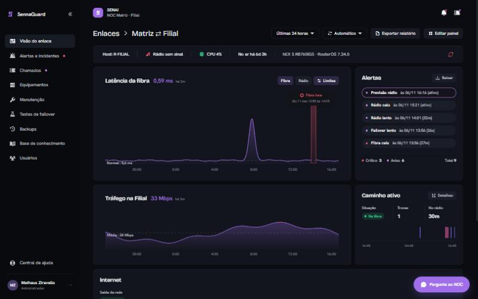

# SennaGuard

Painel web do NOC, parte do monorepo [noc-senai-tcc](https://github.com/MathZiraA/noc-senai-tcc) (diretório `sennaguard/`). Apresenta, em tempo real, o estado do enlace Fibra/Rádio entre Matriz e Filial, os alertas com o laudo do Analista IA, os chamados com SLA e livro encadeado por SHA-256, e a gestão de equipamentos e usuários — com acesso segregado por perfil.



## Arquitetura

Backend em **FastAPI** (Python) e interface em **React/TypeScript**, publicados pelo mesmo Apache do Zabbix em `https://<servidor>/sennaguard/`. O painel não coleta métricas por conta própria: lê o Zabbix pela API, os roteadores por SSH somente leitura e o livro de chamados do Analista IA. Uma sonda dedicada de 1 s complementa o Zabbix e reflete quedas em ~2 s; a interface recebe as mudanças em tempo real por SSE.

## Perfis de acesso

| Perfil | Vê | Pode |
| --- | --- | --- |
| Administrador | tudo | o que o Analista pode, mais usuários, telas de TV e aprovar testes de failover. Não abre chamado |
| Analista | enlace, alertas (com análise da IA), chamados, equipamentos, backups, relatórios | reconhecer alertas, atender chamados, manutenções, base de conhecimento, pedir teste de failover. Não abre chamado |
| Operador | enlace, alertas, chamados, equipamentos, manutenções | reconhecer alertas, atender chamados. Não abre chamado nem pede teste |
| Cliente | estado do enlace, os chamados automáticos e os que ele abriu | abrir chamados (SG-xxx) e responder |

Quem abre chamado é sempre o cliente; a equipe do NOC atende. O teste de failover derruba a fibra de propósito: o Analista pede e só o Administrador aprova.

**Segurança do acesso:** senhas com *scrypt*, sessão em cookie `HttpOnly` + `SameSite=Strict` (12 h), bloqueio temporário após tentativas malsucedidas e a garantia de ao menos um administrador ativo. Toda autorização é verificada no servidor, por perfil.

## Chamados

- **Automáticos (NOC-xxx):** queda acima de 1 h, gerados pelo `noc/chamados.py` do noc-senai-tcc.
- **Abertos pelas pessoas (SG-xxx):**
  - o cliente informa o tipo do problema, quem é afetado e a descrição;
  - o estado da fibra e do rádio no momento da abertura é anexado sozinho;
  - a equipe assume o atendimento, responde e resolve;
  - se o cliente responde um chamado resolvido, ele é reaberto.

Cada passo entra num histórico encadeado por SHA-256, e a tela de Chamados acusa qualquer alteração.

## Funcionalidades

| Área | O que faz |
| --- | --- |
| Tempo real | o painel atualiza na hora (SSE em `/api/eventos`); sonda própria de 1 s na fibra e no rádio (`backend/sonda.py`): queda aparece em ~2 s e a volta em ~1 s, sem esperar o Zabbix |
| Atualizar a cada | como no Grafana: Automático (1 s em períodos curtos, 10 s nos longos, e na hora quando um enlace muda), Desligado, 1 s a 5 min, seguido à risca e lembrado no navegador |
| Telegram | chamado novo, respostas, alertas (Média ou maior), manutenções, testes e relatório mensal; cada pessoa conecta a conta no menu |
| SLA | 24x7: Filial inteira 15 min / 4 h, setor 30 min / 8 h, um PC 1 h / 24 h |
| Incidentes | alertas do mesmo host em até 60 s agrupados; "a análise foi útil?" gera a precisão do Analista IA |
| TV | link fixo e revogável (Usuários → Telas de TV), sem login |
| Relatório | PDF de SLA sob demanda; todo dia 1º, o do mês anterior vai aos administradores |
| Manutenção | janelas criadas também no Zabbix, faixa no painel, aviso 1 h antes, alertas silenciados |
| Mapa | nós e equipamentos clicáveis, com interfaces, tráfego e recursos (SNMP); sinal do rádio em dBm |
| Backups | `/export terse` diário dos dois roteadores, histórico, diferença e explicação pela IA |
| Chat | "Pergunte ao NOC": IA com ferramentas só de leitura; o cliente vê apenas o que é da Filial |
| Teste de failover | pedido → aprovação do admin → fibra desligada 60 s no R-MATRIZ → laudo em PDF |
| Base de conhecimento | chamado resolvido vira rascunho (IA), o analista publica; sugestões ao abrir chamado |
| Tema | escuro (padrão) ou claro, no menu do usuário |
| Celular | barra inferior com os atalhos do papel + "Mais"; tabelas viram cartões |
| Visão personalizável | cada pessoa arrasta e esconde os cartões; salvo na conta |
| Período e zoom | 5, 10 e 30 min (1 ponto por segundo, da sonda), 1 h a 30 dias ou intervalo livre; arrastar no gráfico dá zoom |
| Conversa no chamado | anexos (imagem/PDF até 5 MB, Ctrl+V cola print), nota interna da equipe, "visto às" em tempo real |
| Perfil | foto, troca de e-mail com senha, avisos do Telegram por tipo e severidade, não perturbe 22 h–7 h |
| Tour | no 1º acesso (roteiro de cliente ou de equipe); refazer pelo menu |

## Instalação

Os instaladores e os guias ficam na pasta [`instalacao/`](../instalacao) do projeto. Passo a passo completo (servidor e teste local no Windows/Linux): [`instalacao/sennaguard.md`](../instalacao/sennaguard.md).

## No servidor do NOC (Debian 12, junto do Zabbix)

Com o projeto já em `/opt/noc-senai-tcc` (cópia/rsync/pendrive — **não** por git) e o NOC instalado:

```bash
bash /opt/noc-senai-tcc/instalacao/instalar-sennaguard.sh   # pede o e-mail e a senha do primeiro administrador
```

O instalador:

- lê o token do Zabbix de `/root/.zabbix_token` e os IPs de `/etc/noc/noc.conf`;
- compila a interface;
- cria o serviço `sennaguard` (usuário próprio, só em `127.0.0.1:8010`);
- publica pelo Apache em **`https://<SERVIDOR_IP>/sennaguard/`**.

O instalador também prepara as integrações:

- **Telegram:** pergunta o token do bot (`@BotFather`).
- **IA:** copia as chaves de `/root/.gemini_key` e `/root/.anthropic_key`.
- **Backup:** copia a chave SSH do Analista IA (usuário `zabbix-ia`, só leitura).
- **Teste de failover:** gera a chave do usuário `sennaguard-teste` e mostra os comandos RouterOS para criá-lo no R-MATRIZ.

**Acesso pela Filial:** o PC na rede `192.168.20.0/24` abre `https://192.168.10.50/sennaguard/`. O caminho é a fibra, ou o rádio se a fibra cair. O firewall do R-MATRIZ já libera `Filial -> Matriz` e não precisa de mudança. O PC precisa confiar na CA do NOC (`http://192.168.10.50/NOC-SENAI-CA.crt`), como já é feito para o Zabbix.

| Tarefa | Comando |
| --- | --- |
| Atualizar (após copiar a versão nova para `/opt/noc-senai-tcc`) | `bash /opt/noc-senai-tcc/instalacao/atualizar-sennaguard.sh` |
| Redefinir a senha de alguém pelo terminal | `cd /opt/noc-senai-tcc/sennaguard/backend && sudo -u sennaguard env $(cat /etc/sennaguard/sennaguard.env \| xargs) ../.venv/bin/python gerenciar.py redefinir-senha --email x@y` |
| Ver o log | `journalctl -u sennaguard -f` |

## Desenvolvimento (Windows ou Linux)

```bash
cd backend && pip install -r requirements.txt && uvicorn main:app --reload --port 8000
cd frontend && npm install && npm run dev      # http://localhost:5173/sennaguard/
```

Sem `ZABBIX_URL`/`ZABBIX_TOKEN` a API roda em **simulação**: valores da bancada real e um cenário com o rádio fora e um chamado aberto. Usuários de demonstração com a senha `senai2026`: `matheus.ziravello@gmail.com` (administrador) e `cliente@filial.local` (cliente).

## Estrutura

- `backend/main.py`: rotas `/api/*`, sessão e usuários (SQLite)
- `backend/auth.py`: senhas, sessões e permissões por perfil
- `backend/fonte.py`: Zabbix ou simulação
- `backend/livro.py`: livro de chamados (mesmo formato de `noc/chamados.py`)
- `frontend/src/components/Trilho.tsx`: o trilho do caminho ativo (Matriz ⇄ Filial)
- `deploy/`: instalador, serviço systemd e configuração do Apache

Guia de instalação do painel: [`instalacao/sennaguard.md`](../instalacao/sennaguard.md).
